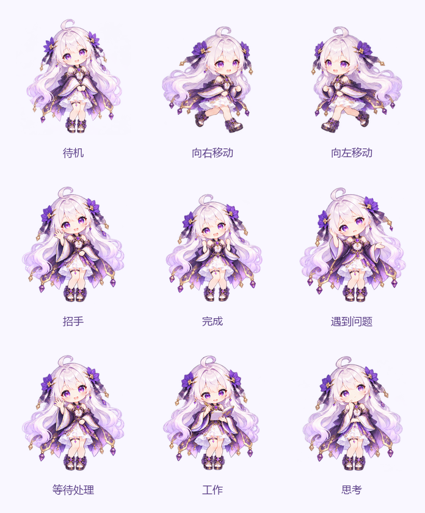

# FREYJA Agent 宠物

参照系统背景的银白长发、紫色眼睛、紫金花饰和白紫裙装，使用 Codex 内置 imagegen 生成 Q 版人物关键帧，再离线组装为 [Codex Pet](https://codex-pet.org/zh/codex-pet-json/) 标准包。运行时使用透明精灵图，不再使用 GIF。

## 使用

进入 **管理 → Agent 配置 → 虚拟形象**。点击 **上传 ZIP** 可导入社区宠物包；点击 **恢复默认** 可重新选择 FREYJA。保存后立即更新悬浮宠物。当前标准下载包位于 `front/public/agent/freyja/freyja-local-motion.codex-pet.zip`，可下载后重新上传；旧包保留。

宠物显示为约 **224 × 243 CSS 像素**，没有背景、边框或容器阴影；拖动时播放左右移动动作。点击可打开或关闭聊天窗口。完成、失败、需要回答时显示可点击气泡。

默认 FREYJA 使用**局部动作图集**，每个动作固定一张底图，只允许指定动作区域变化。待机与失败只改变眼睑，等待与思考只改变眼睛内部，招手、完成与工作只改变手部，左右移动只改变腿和鞋。头部位置、头发、饰品、服饰等非动作区域逐像素锁定。九行动作仍各有 16 个画格；它们由八帧 AI 动作源图裁切、局部合成并补间得到，移动帧使用原画重复保持，左移镜像右移，**不代表 144 张独立生成的原画**。轻动作仍往返播放，左右移动顺序循环。

默认形象在局部动作帧基础上按用户反馈**加快 25%**（周期缩短 20%），`freyjaAnimationDurationScale` 从 4 调整到 3.2。待机一轮约 **10.24 秒**，其中活动和停顿各 5.12 秒；招手一轮 4.48 秒，思考一轮约 6.59 秒。配置预览和悬浮宠物共用播放逻辑。局部动作图集解决图片整身重绘带来的细节漂移，验证包括 PNG 编码再解码后的非动作区域一致性。

社区宠物继续使用标准 8 列及既有 **0.5 倍速度**，待机每轮停顿 1 秒、周期 3.2 秒。前端 `avatarPresets.ts` 的 `petPlaybackRate` 控制社区播放速度；`freyjaAnimationDurationScale` 控制默认形象的额外放慢倍数，数值越大越慢。

播放器按 `requestAnimationFrame` 的实际经过时间采样，不累计定时器漂移；页面隐藏时暂停，恢复后接着播放，系统开启「减弱动态效果」时静止。等待图片加载完成后启动动画；增强图集加载失败时自动回退原始图集。

2026-10-11 已在 WSL Docker 部署后通过 Chrome 对比九种动作及悬浮宠物的实际帧周期：待机由约 1.1 秒变为 3.2 秒，其他动作约为原周期的两倍，无浏览器异常。TypeScript、Vite 与 Docker 构建通过；测量结果保留在 `logs/agent-pet-speed-before.json` 和 `logs/agent-pet-speed-after.json`，未修改助手配置或业务数据。



当前帧图、局部动作范围与校验结果见 [局部动作验证](local-motion-validation.md)。旧版记录见 [播放验证](smooth-playback-validation.md) 和 [后续减速验证](slower-playback-validation.md)。

## 包格式

ZIP 根目录或一个外层文件夹中放置 `pet.json` 和其 `spritesheetPath` 指定的静态透明 WebP/PNG：

```json
{
  "id": "freyja",
  "displayName": "FREYJA",
  "description": "银白发、紫金花饰的 Q 版创作助手",
  "spritesheetPath": "spritesheet.webp",
  "spriteVersionNumber": 1
}
```

每格 **192 × 208**，8 列；v1 为 9 行（1536 × 1872），v2 为 11 行（1536 × 2288）。缺少版本号时按画布行数识别。v2 最后两行方向帧可保留，当前 FREYJA 使用前九行动作。

内置默认形象额外使用 **16 列 × 9 行**的无损透明 PNG `spritesheet-local-motion-v3.png`（3072 × 1872）；`v3` 为资源修订名。不会将这种画布传入社区 ZIP 上传接口。标准下载 ZIP 使用 8 列透明图集 `spritesheet-local-motion-codex.png`，遵循下表帧数；重新上传后按社区标准播放。仅内置默认 URL 启用完整 16 帧，上传包不会因名称或 ID 相同而改变格式。

| 行 | 标准动作 | 帧数 | FREYJA 状态 |
| --- | --- | --- | --- |
| 0 | idle | 6 | 待机 |
| 1 | running-right | 8 | 向右拖动 |
| 2 | running-left | 8 | 向左拖动 |
| 3 | waving | 4 | 招手预览 |
| 4 | jumping | 5 | 任务完成 |
| 5 | failed | 8 | 任务失败 |
| 6 | waiting | 6 | 等待用户处理 |
| 7 | running | 6 | 工具工作 |
| 8 | review | 6 | 模型思考 |

导入上限 20 MB，解压内容上限 32 MB、64 个条目、64 KB 清单。仅将通过校验的精灵图存入 MinIO，不在磁盘解压 ZIP、不执行包内容。拒绝路径穿越、重复路径、多个清单、外链精灵图、错误画布尺寸和动态 WebP/GIF。

## 复现

当前动作使用内置 imagegen 编辑生成；完整提示词在 `local-motion-prompts.json`，八组 AI 源图与动作底图在 `source/local-motion/`。显式区域坐标在 `local-motion-regions.json`。离线合成用 Chrome Canvas，只将这些区域内的新原画合成到底图；编码后逐像素验证区域外一致性，失败则停止。PNG 无损保留共享像素；原画及旧图集保留。

```powershell
node scripts/assemble_agent_pet_local_motion.cjs
```

该脚本使用本机 Chrome 与 `logs/browser-tools/node_modules/playwright-core`（离线工具，可用 `npm install --prefix logs/browser-tools playwright-core` 准备），Python 标准库仅用于写 ZIP，无应用运行时依赖。`--prepare` 从保留的旧图集中提取每行动作底图与八格编辑模板，不调用生图服务。重新生成 AI 源图后运行默认命令，输出平台图集、标准 ZIP、144 张单帧 PNG、帧图预览、范围预览及 `local-motion-validation.json`。

以下命令仅复现旧版本。

`source/` 保存七张原始透明 PNG；`prompts.json` 保存人物生成提示词。使用已安装 Pillow 的 Python 环境运行：

```powershell
python scripts/assemble_agent_avatar.py
```

脚本提取原始人物帧、统一尺寸和脚部位置，输出静态无损 WebP、标准清单和 ZIP；`validation.json` 记录画布、各行非空帧、透明度和 SHA-256。Pillow 仅用于离线制作，没有新增应用运行时依赖。

新增帧的七张源图在 `source/smooth/`，提示词在 `smooth-prompts.json`。离线组装需要 Pillow、NumPy、OpenCV：

```powershell
python scripts/assemble_agent_pet_smooth.py
```

此脚本只裁切、对齐、缩放已有 AI 原画，按主要轮廓去除相邻格碎片，并对齐上部头部中心和地面基线；不重新绘制人物。生成内置图集、标准 ZIP、`smooth-frames-preview.png` 和带各行动作帧数/哈希的 `smooth-validation.json`。源图及旧图集不覆盖；这些 Python 库不是应用运行时依赖。
