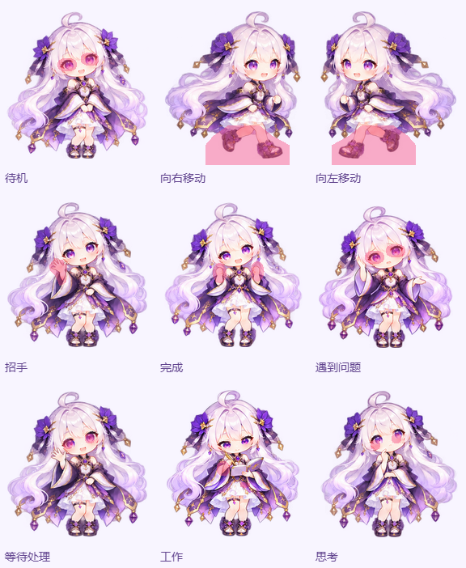
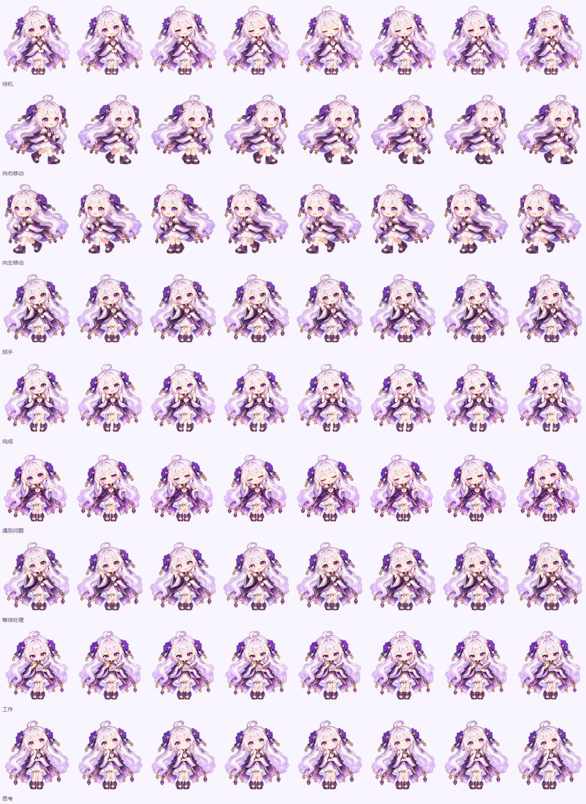

# FREYJA pet 局部动作帧（2026-10-12）

此前每一帧分别重画整个人物，发丝、脸型、裙装纹理与饰品随帧变化；增加帧数和降低速度无法消除这种漂移。本轮使用内置 `image_gen.imagegen` 按动作编辑八组八格源图，将允许运动的局部区域合成到各自动作的同一底图上，保留其余 RGBA 像素。

| 动作 | 允许变化的区域 |
| --- | --- |
| 待机 | 两眼眼睑，缓慢眨眼 |
| 向右移动 | 裙摆以下的腿部和鞋，固定上半身 |
| 向左移动 | 右移动作的精确水平镜像 |
| 招手 | 贴近脸侧的一只手和短前臂 |
| 完成 | 两只手和短前臂，小幅举手庆祝 |
| 遇到问题 | 两眼眼睑，缓慢闭眼 |
| 等待处理 | 眼睛内部，小幅视线变化 |
| 工作 | 两手手指和手腕，书本主体固定 |
| 思考 | 眼睛内部，小幅视线变化 |

完成状态保留标准 `jumping` 行号，但采用原地小幅举手，以符合固定身体的要求。每行动作保留原先的静态姿势；这保证同一动作内的帧一致性，不要求切换不同动作时仍保持同一姿势。

源图由 imagegen 实际生成，完整提示词见 [local-motion-prompts.json](local-motion-prompts.json)，各行动作范围见 [local-motion-regions.json](local-motion-regions.json)。使用 Chrome Canvas 对齐新原画的头部后，只取指定区域，并在区域内侧做两像素边缘融合。区域外直接复制底图；小幅手眼动作使用预乘 RGBA 补间，移动使用原画保持，避免双脚重影。内置图集各行循环起止使用相同画格。

内置图集为 3072 × 1872，16 列 × 9 行、每格 192 × 208。标准 ZIP 的 PNG 为 1536 × 1872、8 列 × 9 行，保留 Codex Pet v1 各行帧数。源图为八组 × 八帧，左移镜像右移；最终 144 个画格包含补间与重复保持帧，不是 144 张独立 AI 原画。

离线校验在合成后及 PNG 编码再解码后检查全部画格：九行动作的区域外像素差异均为 **0**。范围、对齐参数、图集大小与 SHA-256 见 [local-motion-validation.json](local-motion-validation.json)。

前端 TypeScript/Vite 生产构建通过。JDK 26 + Maven wrapper 的 `AgentAvatarMediaServiceTest` 共 10 项通过，包含新 PNG 包的透明格式、8 列/9 行尺寸及上传后原始图片字节一致性。

局部重绘阶段保留了此前各行动作周期、页面隐藏暂停、系统减弱动态效果及社区宠物兼容行为。内置资源和下载包使用新的版本文件名，刷新后不会复用旧图集缓存。

Chrome 在生产构建预览完成九行动作及悬浮宠物采样：待机周期 12801 ms，移动 8478 ms，招手 5599 ms，完成 6719 ms，失败 9761 ms，等待 8078 ms，工作 6563 ms，思考 8239 ms，均在既有目标周期 ±100 ms 内。点击开关聊天、左右拖动、隐藏/恢复、减弱动态效果、增强图集失效回退、社区 v1/v2 包兼容均通过；浏览器错误为 0，配置读取前后哈希相同，测试隔离所有业务写请求且实际记录为 0 次。原始记录在忽略的 `logs/agent-pet-local-motion-preview-browser.json` 与 `logs/agent-pet-local-motion-preview-timing.json`。

已更新 WSL Docker 的 `frontend` 容器，入口为 http://localhost/system/agent 。部署后重复采样九行动作与悬浮宠物、点击/拖动、减弱动态效果及隐藏/恢复，全部通过，无浏览器错误，配置哈希保持一致。九个预览实际使用 `spritesheet-local-motion-v3.png`，下载链接为新 ZIP；平台返回两张 PNG 与 ZIP 的 SHA-256 均与工作区一致。后端容器保持原实例。部署后汇总见 [local-motion-playback-validation.json](local-motion-playback-validation.json)，服务端字节核验见 [local-motion-served-validation.json](local-motion-served-validation.json)。回退镜像为 `astrag1/freyja-frontend:pre-pet-local-motion-20261012`。

## 小幅提速（2026-10-12）

根据用户反馈，默认形象的 `freyjaAnimationDurationScale` 从 4 调整到 3.2，播放速度提高 25%、每轮周期缩短 20%。动作帧及播放顺序保持原样，社区宠物的标准周期保持原样。生产构建和九种动作的周期/帧范围检查通过。

本机前端更新后，Chrome 实测待机 10243 ms、右移/左移 6779 ms、招手 4481 ms、完成 5377 ms、失败 7806 ms、等待 6467 ms、工作 5250 ms、思考 6590 ms，均符合提速后的目标。悬浮宠物待机周期为 10244 ms；点击、拖动、减弱动态效果及隐藏/恢复验证通过，无浏览器异常或业务写请求，配置哈希一致。汇总见 [local-motion-faster-playback-validation.json](local-motion-faster-playback-validation.json)。回退镜像为 `astrag1/freyja-frontend:pre-pet-faster-20261012`。
