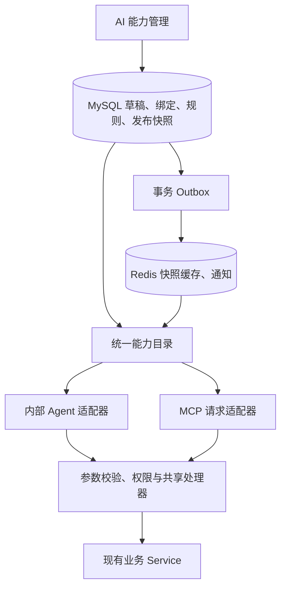

# 内部 Agent 与 MCP 统一能力平台

本次已实施 MySQL/Redis 驱动的统一目录。内部 Agent 直接调用共享 Java 能力层，外部 Agent 通过 MCP 适配同一批业务处理器。沿用现有依赖，不新增远程调用或重复任务系统。

## 架构与管理

后台路径 `/system/ai-capabilities`：按入口查看能力，编辑完整工具名称、说明、Schema、公共规则和外部指南，保存草稿后发布；发布历史支持回滚。草稿不影响运行。修改名称无需修改 Java 或重启；新增业务动作仍需实现处理器。

Java 只注册明确的可执行处理器及硬约束，首次启动将初始配置导入数据库。CRUD 对象与操作使用枚举和明确的方法引用，不通过单复数或名称前缀猜测行为。`MCP:get_shot` 等 handlerKey 是稳定的内部注册键，工具公开名称独立保存于绑定中，修改公开名称不改变执行与权限。

本轮支持编辑已注册绑定，不提供任意脚本、动态 Java 代码或新增/删除处理器绑定。Schema 可改说明或收紧支持的约束，不能增加未知字段、修改字段类型、放宽硬约束或把写操作声明为只读。

处理器 Schema 升级时，后端启动后根据 `ai_capability_version.contract_json` 中的旧处理器契约，对已发布版本和草稿分别迁移：移除已废弃字段，保留仍适用的自定义说明和更严格约束，并发布新的兼容版本。历史发布内容及摘要保持原样；草稿的待发布规则和说明保留。若自定义约束与新处理器冲突，AI 能力管理页会指出能力及 JSON 路径，草稿仍可编辑和保存其他内容；选择“恢复当前参数结构”后保存、发布即可修复。冲突期间 Agent 配置和 MCP 服务只展示可安全执行的能力，冲突绑定不会对外开放。

## 实际数据表

| 表 | 用途 |
|---|---|
| ai_capability_catalog_state | 唯一配置修订、当前发布指针、草稿 JSON |
| ai_capability_definition | 稳定能力身份和注册处理器 |
| ai_capability_version | 发布时生成的不可变处理器契约版本 |
| ai_capability_binding | 能力与入口/Profile、完整工具名、Schema、启用状态、上下文模式的绑定 |
| ai_capability_rule | 公共创作规则与 MCP 指南 |
| ai_capability_release | 完整不可变发布 JSON、SHA-256、修订、说明与时间 |
| ai_capability_outbox | 发布事务内记录的 Redis 通知事件和重试状态 |

迁移脚本：`src/main/resources/sql/upgrade_unified_capabilities.sql`，只使用 `CREATE TABLE IF NOT EXISTS`。应用启动增量初始化，Docker 新库初始化脚本也包含相同表结构。

MCP 令牌、Origin、项目范围和总写开关继续使用既有 `sys_config/mcp.server.settings`，不重复建立 MCP 配置表。令牌不进入能力快照或 Redis。内部模型、预算、记忆、头像等设置继续使用 `agent_config`。

所有实体 ID 使用字符串，包括模型工具 Schema 和前端。内部 Agent 的 Long 参数在统一 Schema 中转为字符串 ID，后端精确解析，禁止前端 `Number(id)`。

## 发布与缓存

保存、发布、回滚均检查调用者提供的配置修订，过期返回 409。MySQL 事务锁定目录状态，写入新契约、完整发布、当前指针和 Outbox 后一起提交。回滚创建新的递增修订，不改历史发布。

Redis 键：`freyja:capability:v1:release:{releaseId}`（24 小时）、`freyja:capability:v1:instance:{instanceId}`（30 秒）；通知频道 `freyja:capability:v1:events`。5 秒刷新扫描补投通知。每次请求检查 MySQL 当前发布指针；即使通知丢失也能发现新版本。Redis 故障或快照摘要不匹配时回源 MySQL，业务正确性不依赖 Redis 锁。

MCP 每个请求捕获同一个完整发布快照，初始化说明、工具发现、Schema 和处理器来自该快照。采用 SDK 的 Tool/CallToolRequest/CallToolResult 和参数校验，不逐条更新 SDK 工具列表。未实现目录变更推送，因此 `listChanged=false`；客户端在配置变更后重新发现工具。

## 内部 Agent 复用

内部 Agent 可以选择共享的项目、剧集、场次、分镜、人物、造型、资产查询和写入工具，替代原先重复查询实现。项目来自服务端会话，`dramaId` 不由模型伪造；写入幂等标识由 Step 生成。测试模式禁止业务写入及读取写入操作结果。

会话/Run、任务计划、记忆、Skill 加载和生产工作流能力纳入统一目录，但仍只授权内部入口。它们需要持久化运行上下文，未直接暴露给外部 MCP。外部 MCP 总开关不影响内部调用；外部仍使用 Bearer、Origin 和项目授权。

新 Run 固定 releaseId、完整绑定、参数 Schema 和版本，并使用该发布的公共规则。执行时检查最新绑定启用状态，撤权即时生效；改名不会改变已经固定的运行契约。内部异步提示词任务持久化服务器生成的规则副本，重启恢复继续使用该副本；HTTP 请求不能覆盖该字段。

**按本次要求，不兼容旧内部 Agent 会话/Run，不导入旧工具别名。升级后请新建会话。** 不删除旧会话或业务数据。保留模型/预算等现有设置，旧名称选择会被当前目录过滤；需要在助手配置中选择新的共享能力并保存。

## 共同创作规则

- 场景类型/时段无隐式默认，枚举列入 Schema；省略更新字段保留，显式 null 按字段契约清空。
- 新项目画幅显式选择数据库启用项；已有项目保留原画幅；用户委托 AI 选择时优先启用的 16:9。
- 普通完整动作参考 3–5 秒，舒适长镜头参考 7–8 秒，超过 8 秒优先按完整动作、对白轮次和叙事转折拆分，避免碎镜。
- REFERENCE_MODE 使用 prompt 与有序 refImages；FIRST_LAST_FRAME 使用 videoPrompt 与首尾帧提示词/图片。
- 默认无背景音乐，保留对白、环境声和必要音效；模型契约要求时 non_diegetic_music 写 N/A。用户明确需要配乐时，内部制作规划设置 includeBgm=true，提示词服务按显式决策处理；不通过关键词猜测用户意图。
- 关键写入后引导 Agent 读回核对场景、时长、模式、提示词、人物/造型引用，再以最新指纹修正。

## 管理 API

所有接口采用现有 `R` 响应，前缀 `/system/ai-capabilities`。

| 方法与路径 | 请求/行为 |
|---|---|
| GET / | 返回 revision、active、draft、releases、handlers |
| PUT /draft | `{revision, bindings, instructions, rules}`；保存并递增配置修订 |
| POST /publish | `{revision, note}`；发布完整草稿 |
| POST /rollback | `{revision, releaseId}`；发布目标内容的新版本 |

MCP 管理页保留连接、授权和即时工具开关；即时开关只发布该工具状态，不会顺带发布未完成的其他草稿修改。

## 验证

后端覆盖 MCP 协议与权限、Agent 配置与执行、检查点/恢复、生产规划和提示词。独立 `freyja_capability_it` 数据库配合真实 Redis 验证并发发布冲突、第二实例发现、回滚、缓存故障回源、名称更新、会话上下文防伪、规则固定与改名后的写权限。

运行专用集成测试需显式设置 `FREYJA_CAPABILITY_IT=true`，JDBC URL 必须指向 `freyja_capability_it`；测试清理仅限该库的七张能力元数据表。常规 `mvnw test` 默认跳过该环境测试。

本次验证结果：主要后端回归 249 项无失败（4 项依赖环境跳过）；真实 MySQL/Redis 专项及规则/Schema 测试 9 项通过；最终生产规划、提示词等针对性验证 79 项通过。后端打包、前端构建、浏览器编辑/JSON错误/草稿/发布交互通过。完整应用实际启动验证得到 160 个绑定、内部 88 个可选工具、外部 MCP 72 个已发布工具。浏览器写操作使用模拟接口，未生成实际模型或媒体任务。
