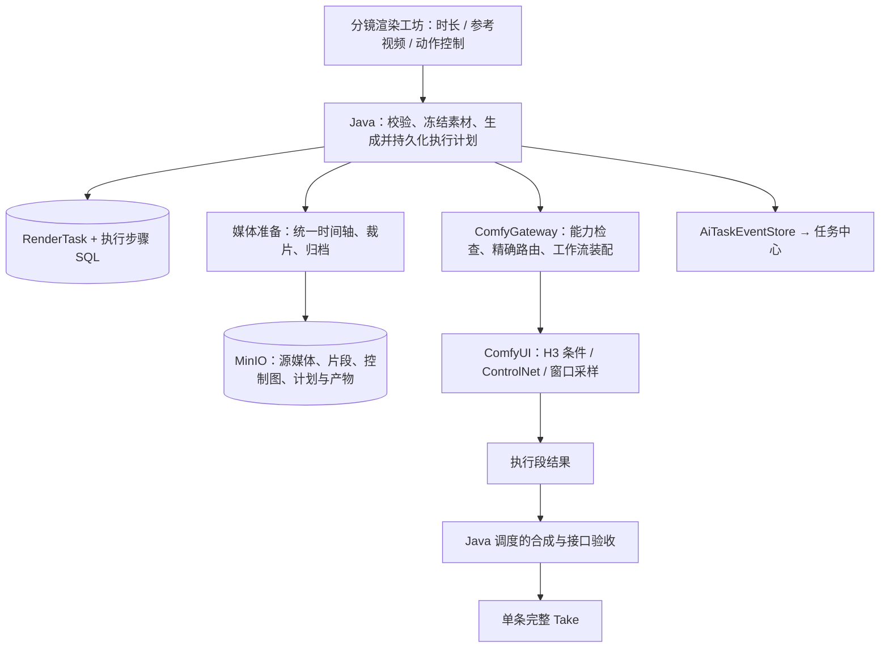

# MiniMax H3 长镜头、上下文窗口与 ControlNet Union 接入设计

日期：2026-11-06。状态：H3 已统一接入官方节点，自定义 ComfyUI 节点已移除，目标 GPU 组合渲染尚未验收。

## 0. 实施状态与阅读说明

部署、实际接口和当前限制以 [MiniMax H3 接续部署与验收说明](minimax-h3-continuation-deployment.md) 为准。以下保留完整设计目标，不能把其中建议能力视为已通过 GPU 验收。

已实现：单镜头接续开关、自动/手动分段、片段素材明确挂载、长源视频按时间轴分配、片段可选官方 ControlNet、官方窗口及音画 Guide 接线、后台素材准备、SQL 分段恢复、一个最终 Take。所有当前 H3 模板已有显式模块绑定，各模板仍需独立验收。灰度转换与控制源帧数检查由网关完成，参考原视频保持彩色。

当前手动调整直接编辑合法生成帧范围；保留区间由服务端计算。尚未提供任意成片切点编辑、自动找最佳接缝、几何/亮度修复、接口视频预览、独立母带音轨策略、窗口采样断点恢复及资源成本预测。拼接目前采用固定真实重叠裁切和 FFmpeg 帧数校验；这不能证明运动或对白已经无缝。源视频按各绑定准备，尚未实现全源一次标准化后的共享母带缓存。

产品计划上限为 300 秒，单段不超过 362 帧；这些是请求约束，不是实测质量或显存承诺。提供 5 / 8 / 10 / 15 秒档位，新草稿默认 124 帧段长和 22 帧重叠，旧草稿保留原设置。长参考视频可在上传后自动按当前计划产生明确切片绑定，实际裁片在后台素材准备阶段完成。默认参考预算为 15 秒 / 360 帧；使用 362 帧控制源须先验收并同步扩大 Java 与网关参考预算。

## 1. 推荐决策

按创作者确认的范围，当前视频生成工作流均以 MiniMax H3 架构接入，保留 `TXT2VIDEO_REF` / `TXT2VIDEO_FIRST_LAST` 模型类型；具体模板的条件节点、LoRA、修复阶段等差异使用显式配置。先用官方 H3 Ref2VA Turbo8 验证接线，再覆盖当前其他 H3 生成工作流。一个分镜仍对应一次创作请求，成功后生成一条完整视频 Take；内部执行段不是新的剧情分镜。

产品只暴露一个默认关闭的「接续模式」开关：

| 开关状态 | 时长与执行规则 | 参考视频与 ControlNet | 提交前展示 |
| --- | --- | --- | --- |
| 关闭 | 普通单段生成，用户请求时长不得超过 15 秒，并受模型更小的上限约束 | 有有效参考视频时可选启用 ControlNet，默认关闭；无视频不接入 | 普通渲染信息 |
| 开启 | 允许超过 15 秒，但不超过模型与节点已验收的接续上限；采用 `SEGMENTED_CONTINUATION` | 与开关关闭时相同；按各执行段的时间映射取控制素材 | 自动预览接续段数、各段区间、重叠、参考覆盖与最终时长 |

接续不以存在参考视频为前提。没有参考视频也可以根据上一段的生成上下文续接；参考视频只提供 ControlNet 的启用前提，实际是否启用由独立的 `controlNet.enabled` 开关决定，默认关闭。有参考视频但未启用 ControlNet 时，沿用普通语义参考链路，不生成控制信号、不加载补丁。

接续模式下参考图、参考视频必须显式挂载到目标片段，不继承全镜头素材列表。素材可以从同一个资源托盘选取并绑定到多个片段；它们最终都是独立、可见的片段绑定。普通素材不强制填写逐项用途说明，不要求选择身份图、风格片或动作片等分类；用户通过片段归属和该段 prompt 表达创作意图。

`MiniMaxH3ContextWindows` 是执行段内部的采样配置，由已经验收的工作流配置决定，不作为第二个用户模式。窗口数与接续执行段数分别记录，预览中的「几段接续」只计算实际生成片段。以后如果支持一次采样直接生成整条长视频，也必须受接续开关约束，不能通过内部自动路由绕过 15 秒门槛。

开启但请求时长仍在普通单段能力内时，计划可以只有一段，显示「1 段，无需跨段接续」，不强制制造接缝。请求时长为 15 秒时允许底层按 H3 帧网格渲染到 362 帧，但默认成片仍按请求裁剪；该技术对齐不表示用户请求可以超过 15 秒。

关闭开关时如果草稿时长已经超过 15 秒，保留草稿并标记不可提交，提示缩短时长或重新开启接续；不静默把时长改成 15 秒。服务端和网关均校验此条件，不能只禁用前端输入框。

建议上线顺序：官方 Guide 串行续接 → 按段切分参考视频与官方 ControlNet → 官方窗口单独验收 → 官方窗口与 ControlNet 联用验收。30 秒、60 秒只作为验收档位，不预先宣称它们是任意 GPU 上的可用上限。

### 1.1 接续功能的归属建议

接续开关归属单镜头。`DramaShotGroup` 现有职责是承载连续动作链、对白或情绪事件，并组织可拆分、合并、重排的多个分镜；它允许景别和机位变化。一个长镜头内部的多个生成段则共享一条连续时间轴，最终形成一个 Take。

推荐层级为「镜头组 → 分镜 → 内部执行段」。镜头组保留批量渲染、汇总各镜头段数与依赖预览的入口，未来也可以批量设置选中镜头的接续开关，但有效值保存在各镜头，避免组设置与镜头设置双重继承。组内镜头移动、拆组和重排不改变镜头自身的接续参数。

跨镜头的尾帧衔接或叙事连续性应作为独立的组级能力。如果以后需要把组内多个已写好的分镜重构为一个连续长镜头，应显式建立新的目标镜头和结构化时间轴，保留来源快照；不能把每个分镜直接当作无缝执行段，也不能覆盖各镜头的 Take 记录。

## 2. 当前工程事实

以当前源码为准，旧设计文档中的“待实现”不代表当前缺口。

- `comfy_gateway/workflow_engine.py` 已有 Ref2VA 图片、音频、视频的动态装配，以及视频条件到输出的路径校验。
- `comfy_gateway/reference_media.py` 已校验归档视频摘要、下载限制、帧数和尺寸，上传到选定算力节点；不能绕过这些校验直接塞 URL。
- `comfy_gateway/video_reference.py` 已有 `UNSUPPORTED / UNVERIFIED / VERIFIED`、工作流摘要和已验证 backend。默认 `machine_default.yaml` 中参考视频仍标为 `UNVERIFIED`；实际部署可另有验收配置。
- `comfy_gateway/schemas.py::calculate_minimax_length` 已按当前 H3 的 `17k+5` 帧网格向上对齐。
- `VideoBatchPreparation.prepare` 对分镜时长硬编码 `<= 15` 秒，随后才检查模型能力；仅修改模型 JSON 无法解除此限制。
- `ReferenceVideoProperties` 默认允许源文件最长 600 秒，但最终参考片段默认最多 15 秒、360 帧。长源文件和长条件输入是两种不同能力。
- `ShotDrawer.vue` 的时长输入与表单验证也写死了 15 秒，需要联动修改。
- `RenderTask`、视频批次快照、Take 历史与 `AiTaskEventStore` 可以复用；网关现有 `TaskTracker` 是 prompt 运行索引，包含 Redis/内存回退，不能承担新增分段业务计划的持久化。

首期基线：`minimax-h3-ref-turbo8`，API 图 `comfy_gateway/comfyUIApi/minimax_h3_ref2va_official_turbo8.json`，UI 图 `comfyUI_workflow/video_minimax_h3_r2v_official_turbo8.json`。该图主干是：

```text
127 UNETLoader → 145 LoraLoaderModelOnly
                            ├→ 126 BasicGuider
                            └→ 124 BasicScheduler
136 MiniMaxH3ReferenceToVideo → 126 / 125 SamplerCustomAdvanced
125 → 122 VAEDecode + 121 VAEDecodeAudio → 130 CreateVideo → 92 SaveVideo
```

所有当前 H3 生成工作流纳入同一开关协议。Turbo8 的 LoRA 与八步约定保留；各模板的采样与修复约定同样保留，组合接线分别验收，不因同属 H3 就共用未经验证的节点 ID。超分、补帧等后处理入口不属于此生成开关范围。

## 3. 已核对的上游能力与关键限制

### 3.1 上下文窗口

官方 PR [#17425](https://github.com/Comfy-Org/ComfyUI/pull/17425) 于 2026-10-30 合入 H3 上下文窗口支持。原生节点 ID 是 `MiniMaxH3ContextWindows`。它在采样阶段处理窗口，并不输出若干 MP4 后再拼接。

节点以真实视频帧为参数，窗口长度、重叠需要遵循当前 H3 网格；可从 `context_length=124`、`context_overlap=39`、`fuse_method=pyramid`、`freenoise=true` 开始验收。它使用专门的 H3 时序映射，不能照搬通用窗口节点的 latent 帧数或 causal fix 设置。

依据：[原生上下文窗口节点源码](https://github.com/Comfy-Org/ComfyUI/blob/master/comfy_extras/nodes_context_windows.py)。实际输入枚举以部署实例的 `/object_info` 为准。

### 3.2 ControlNet Union

当前实施默认采用 Union 2.0，权重为 `minimax_h3_fun_controlnet_union_2.0_pruned_int8_convrot.safetensors`。前后端统一开放 Canny / Depth / HED / MLSD / Pose / Scribble / Layout / Gray，另保留已处理控制视频入口。Layout 要求上传预先制作的布局信号，不包含自动目标检测/跟踪；Gray 由网关 FFmpeg 生成独立控制副本。模型结构识别与加载交给官方 `ModelPatchLoader`，不增加私有检查节点。预处理、下载及升级验收见 [部署说明](minimax-h3-continuation-deployment.md)。

官方原生入口是 `ModelPatchLoader` 加 `MiniMaxH3FunControlNetApply`，作用于 MODEL 分支；补丁权重位于 `models/model_patches/`。姿态、深度、边缘等控制视频属于逐时刻控制信号，区别于 Ref2VA 的语义参考视频。

依据：[官方使用说明](https://docs.comfy.org/tutorials/video/minimax/minimax-h3-fun-controlnet)。权重必须与底模的 AdaLN 形式匹配；文件存在、节点可见不足以证明组合可用。

### 3.3 官方窗口与 ControlNet 需要单独验收

本次检查的官方 `MiniMaxH3FunControlPatch` 按输入 target shape 准备控制 latent，缓存也依赖 shape；没有看到依据窗口绝对位置选择控制时间段的实现。由此推断：直接串联两个节点存在所有窗口重复使用控制视频开头的风险。这是静态代码判断，须对部署 commit 做非周期动作实验确认。

依据：[H3 节点实现](https://github.com/Comfy-Org/ComfyUI/blob/master/comfy_extras/nodes_minimax_h3.py)、[窗口执行实现](https://github.com/Comfy-Org/ComfyUI/blob/master/comfy/context_windows.py)。

能力中独立声明 `contextWindowsWithControlNet`。当前只接入官方节点，默认 `context_windows_with_control_net: false`；未通过部署版本的真实时序验收时，预览和提交均阻止联用。按段提前切好参考视频后使用普通官方 Apply，不需要启用段内窗口，也不依赖私有适配。不能只改 YAML 就宣称联用已完成。

### 3.4 长参考输入仍有独立成本

原生窗口只缩小每次采样处理的目标范围；参考视频的文本视觉编码、VAE 编码和引用条件不会自然变成零成本。扩展长参考视频需要独立的时间映射和输入预算。模型声明的训练范围与产品实测长视频范围也应分开。

## 4. 分层职责



Java 维护唯一业务任务、步骤依赖与恢复决策。网关执行一份确定的渲染图，提供真实执行身份、进度、状态和下载入口。已有源解析、归档和 FFmpeg 准备服务扩展后复用，避免 Java 和 Python 各自裁剪同一份参考素材。

需要 GPU 的姿态或深度预处理作为独立的网关执行步骤调度；Java 保存其结果与依赖。CPU FFmpeg 标准化、裁片、最终拼接由 Java 媒体服务负责。

不引入另一套常驻 Python 主任务调度器，不将执行计划放进进程内字典。不新增 ShotGroup 来代替单镜头内部段落。

## 5. 工作流扩展方式

### 5.1 以显式端点绑定装配可选模块

在 `ModelConfig` 增加版本化 `h3_extensions` 描述，记录：底模与 LoRA 出口、video/audio VAE、条件节点、Guider/Scheduler 的 MODEL 输入、采样与最终保存节点。所有节点 ID 与 `class_type` 都校验，不按模型名、提示词关键字或“第一个匹配节点”猜测。

推荐在现有模板上做确定性图变换；为该模板提供可直接调试的对应 UI JSON。无需为每种窗口长度复制一份全图，但每个组合的最终图都计算摘要。

```text
UNET → 现有 LoRA / 采样配置
                 → [可选：MiniMaxH3FunControlNetApply]
                 → [可选：MiniMaxH3ContextWindows]
                 ├→ BasicGuider.model
                 └→ BasicScheduler.model

参考图 / 语义参考视频 / 音色 → MiniMaxH3ReferenceToVideo → conditioning + AV latent
控制视频预处理 → control_video
ModelPatchLoader → model_patch
```

上图全部 H3 能力使用官方节点；ControlNet 与上下文窗口同时开启需满足独立联用验收，记录已验证 commit。普通按段接续只需官方 Guide，不额外修改采样 latent 或噪声遮罩。

Guider、Scheduler 和其他实际消费 MODEL 的节点都接最终分支。FaceRefine 有第二阶段，不能只改第一阶段 MODEL；首期不把该组合标为已支持。没有启用的模块从最终图中去除，避免无用权重加载。

### 5.2 官方 ControlNet 时间覆盖与窗口验收

全局计划保存目标帧与控制源的确定映射，Java 按段裁片、归档；网关 FFprobe 检查真实解码帧数覆盖实际输出范围。官方 Apply 负责控制编码及生成网格技术尾部的末帧补齐。Gray 在网关生成独立灰度控制视频，不改变普通语义参考视频。

官方窗口与 ControlNet 的联用使用非周期控制动作、不同窗口绝对时间及不同窗口形状进行 GPU 验收，确认没有重播开头、时间偏移或跨任务缓存串用后，才允许对应模型启用联用配置。当前不维护自定义模型 wrapper 或控制缓存。

ControlNet 只有在「本次请求包含有效且已解析的参考视频」且「创作者显式开启 ControlNet」时装配。没有参考视频或开关关闭时，移除 ModelPatchLoader、ControlNet 和控制预处理分支，不加载补丁权重。参考视频本身的语义条件连接独立保留。

首期只有单一控制流；一条有效参考视频时可直接作为控制源，多条时由创作者明确指定其中一条，其他视频仍可保留语义参考用途。POSE / DEPTH / CANNY 等由创作者明确选择。输入为 RGB 视频时经已注册预处理器生成信号，输入已预处理视频时直接使用；不把 RGB 视频自动当作姿态图。多控制流串联和视频修补另行验收。

所选工作流没有通过「参考视频 + ControlNet」组合验收时，将 ControlNet 选项标为不可用；普通语义参考仍按已有能力校验。提交时若显式开启了不支持的组合则拒绝，不能悄悄移除 ControlNet。删除全部参考视频后，前端关闭 ControlNet、移除控制分支并重新生成计划，重新添加视频不自动开启；接续开关保留原值。后端收到「无有效参考视频但 ControlNet 开启」的矛盾请求时明确拒绝。

## 6. 统一时间轴与分段续接

### 6.1 三种长度各自记录

- `requestedOutputFrames`：用户要求的最终成片帧数。
- `renderFrames`：当前 H3 网格对齐后的实际生成帧数。
- `sourceRange`：参考视频真实采用的范围，与目标时长独立。

当前 H3、24fps 下，令 `N=round(durationSeconds*24)`，`renderFrames` 取满足 `F>=N` 且 `(F-5)%17=0` 的最小值。计划返回请求时长与实际生成时长，音频最终使用相同成片区间。

建议默认成片精确裁至 `N` 帧；如果创作者给了尾帧锚点，必须使锚点位于最终保留范围内，或明确选择对齐时长输出。不能先把锚点放到补齐末帧，再在成片阶段将其裁掉。

### 6.2 执行段计划

所有区间使用 `[startFrame, endFrame)`，源视频先统一到一份 24fps 母带，再按帧切片。禁止每段分别按浮点秒重新转帧率。

段长与上下文重叠是独立的、已验证的配置。示例：段长 `L=362`、重叠 `O=39`，步长 `S=323`，落在当前 H3 的合法块边界。60 秒输入需求对应 `N=1440`，生成覆盖到 `F=1450`，可规划为：

| 执行段 | 全局生成范围 | 段长 | 与上一段共享 |
| --- | --- | --- | --- |
| 0 | `[0,362)` | 362 | 0 |
| 1 | `[323,685)` | 362 | 39 |
| 2 | `[646,1008)` | 362 | 39 |
| 3 | `[969,1331)` | 362 | 39 |
| 4 | `[1292,1450)` | 158 | 39 |

这些是规划示例，不是已验证的 60 秒质量承诺。末段若小于该组合实测最短长度，向前调整或加大尾部渲染范围；记录真实和补齐部分，不能伪造真实参考动作。

#### 6.2.1 自动拆分、手动拆分与微调

接续仍只有一个启用开关。开启后的计划编辑器支持三种操作：自动拆分、手动制定、自动拆分后微调；三者最终保存成同一种执行计划，不维护三套渲染引擎。

默认自动逻辑：

1. 从所选工作流的实测配置读取单段生成上限、推荐段长、合法帧网格和推荐上下文重叠。15 秒是普通生成的请求上限，不是所有模板的可用段长都必须恰好 15 秒。
2. 优先使用推荐段长顺序覆盖目标时间轴，相邻段保留真实重叠；根据最短段长调整末段，最终保留区间无遗漏、无重复计时。
3. 每段只装配显式挂载给本段的图片和视频；没有挂载时不添加普通参考素材。长视频经用户选择「分配到多个片段」后，将源区间展开成各片段的明确绑定；ControlNet 仅在本段挂有视频且显式开启时参与。
4. 首段使用原始条件，后续段串行接收上一段实际生成的多帧上下文；按已经选定的音轨策略处理声音。
5. 有结构化动作/对白时间轴时，可使用其明确边界优化计划；自动语义规划由 AI 输出结构化结果，Java 不按关键词拆动作。无语义时间轴时使用帧数规划，不虚构动作边界。
6. 按既定步骤生成、归档、检查接口、裁去重复上下文、合成和验证，最后保存一个完整 Take。

手动可调整成片切分点、增加/删除执行段、片段 prompt、片段素材和参考源范围，并可锁定已编辑字段。锁定字段与其他约束冲突时显示具体原因，不自动覆盖。默认「重新自动拆分」只重算未锁定部分，完整重置提供单独操作。已有素材绑定按稳定片段 ID 保留；拆段、合段或删除片段时明确展示受影响绑定，提供复制到选定新段或移回待分配区的操作，不能偷偷分发到所有段。

创作者编辑的是成片时间轴；系统为其计算合法生成范围和所需前后余量。手动切点不必直接等于模型生成端点，不能把用户要求保留的时间点静默移动到附近帧网格。无法在预算内覆盖的配置明确提示调整。界面区分生成区间、共享上下文区间和最终保留区间。

所有计划编辑先产生新 revision，并刷新预览。未生成时只重算计划；生成后修改 prompt、素材、seed、生成范围或上下文会使受影响步骤及依赖其输出的后续步骤失效，已归档的前段继续复用。只改最终裁接点且不改变任何后续生成上下文时，可以只重新合成；如果裁接变化同时改变上下文来源，仍需重算依赖。

因此「自动接续后手动微调」同时支持生成前修改计划，以及生成后检查片段并创建修订版本；旧 Take 和旧计划不覆盖。

### 6.3 续接条件

首段使用显式挂载到首段的图片、视频和可选控制输入。下一段接收上一段重叠区间对应的实际生成画面，加上显式挂载给下一段的素材；不自动继承上一段或全镜头普通参考图。需要多个片段都使用同一张角色图时，可一次选中目标片段进行批量挂载。连续性来自带运动的多帧上下文，单张尾帧只能约束外观和姿势。

统一通过官方 `MiniMaxH3AddGuide` 将上一段真实尾部及可选音频作为下一段开头 guide，和明确挂载的控制片段一起使用。它输出 conditioning，采样 latent 保持原工作流来源；不增加前缀写入、噪声遮罩锁定或私有采样适配。旧草稿的锁定选项移除，重新预览后按官方路径执行；旧不可变任务快照若仍要求私有锁定路径则拒绝提交。

Guide 是条件约束，不能等同于输出逐像素锁定。接缝质量需要真实生成后验收，不能仅凭图连接宣称无缝。

同一长镜头的执行段串行依赖。每段使用可复现的派生 seed；相同 seed 本身不保证跨段连续。第 i 段变化会使所有依赖其上下文的后续段失效，不能复用旧后半段。

### 6.4 拼接与音画

每对相邻段在真实共享范围内找动作阶段、位置和速度都合适的切点。计划记清楚保留区间；裁掉重复动作后再拼接，不默认给全片套交叉淡化。

默认不改变已通过的片段。必要的几何、亮度修正只作用于有证据的问题接口；补帧也只对短接口启用。RIFE 等补帧使用模型中心已发布能力，记录模型 ID 和新增帧数；不能用大范围补帧掩盖动作缺失。

音频显式选择：

| 策略 | 用途 | 行为 |
| --- | --- | --- |
| `GENERATED_AV` | 保留 H3 原生生成音频 | 与视频使用同一时间映射裁重叠；续接时携带音频上下文并检查对白重复 |
| `SOURCE_MASTER` | 舞蹈、动作复刻等采用参考母带原音 | 用户明确指定母带后，按同一源到目标映射取音，不和各段生成声音重复叠加 |
| `EXTERNAL_MASTER` | 配音中心或独立音乐母带 | 按最终时间轴铺设，生成片段声音按选择保留或关闭 |
| `MUTE` | 静音产物 | 输出不带音轨 |

参考视频 `includeAudio=true` 仅表示参与生成条件，不表示授权自动采用 `SOURCE_MASTER`。独立音色参考的 2～15 秒约束不因成片变长就自动放开。

## 7. 长参考视频的接入

### 7.1 片段素材与自动上下文

| 输入 | 连接位置 | 时间处理 |
| --- | --- | --- |
| `REFERENCE_VIDEO` | `MiniMaxH3ReferenceToVideo.ref_videos.*` | 使用本段明确挂载的视频及所选源区间 |
| `control_video` | `MiniMaxH3FunControlNetApply.control_video` | 必须与目标时刻明确对应，必要时先提取姿态/深度/边缘 |
| `continuation_context` | guide / continuation latent | 来自上一执行段的实际输出 |

同一源视频可以同时用于语义参考和动作控制，但两者在计划中分别声明。控制视频不自动分配 `<Video N>` 标签；现有 Ref2VA 的素材顺序和 Picture/Video/Audio 编号继续保持一致。

### 7.1.1 每段素材显式挂载

素材资源托盘只负责选择和复用资源，不是自动参与每段生成的全局引用列表。每个片段持有完整 `referenceImages`、`referenceVideos` 列表；未挂载即不参与该段普通参考条件。上一段生成上下文是自动技术输入，独立维护。

| 操作 | 行为 |
| --- | --- |
| 给片段 A 添加图片/视频 | 仅 A 使用该素材，B/C 不受影响 |
| 将同一素材挂到 A/B/C | 用户批量选择目标后，写入三份明确绑定，共用底层不可变资源，不重复上传 |
| 只挂在首段的角色图 | 后续段不隐式添加该图，仍接收前一段生成上下文 |
| 所有段都需要同一角色图 | 提供「挂载到所选片段 / 全部当前片段」快捷操作，新增片段不自动获得绑定 |
| 给片段 B 挂一段视频 | 使用 B 明确选定的源区间，不要求解释它是风格、身份还是动作参考 |
| 从 B 删除素材 | 只删除 B 的绑定，不删除资源，也不改变其他段的绑定 |
| B 启用 ControlNet | B 必须有视频；多条时在 B 内指定控制源，默认关闭 |
| B 没有普通参考素材 | 允许仅使用 prompt 和自动续接上下文，仍受模型实际输入约束 |

素材卡片只要求选择资源，视频按需选择源范围；逐项 `referenceDescription` 可空，片段 prompt 可以统一描述本段画面和动作。素材所属资产类型可沿用已有元数据，但不增加强制的逐图/逐视频语义解释步骤。可选的首尾帧或时间锚点仍属于明确的高级约束，不能把普通挂图自动当作锚点。

空间与色彩标准化在共用源媒体级保持一致，各绑定复用同一母带。控制信号能预处理一次再按帧切分时优先复用；需要分批 GPU 处理时保留必要的算法上下文与尺度基准，检查批次边界，避免逐段归一化或跟踪状态重置产生跳变。

每段素材数量、帧数、像素和 token 成本均独立校验。超过预算时定位到该段的具体素材，不能静默丢弃。绑定的增加、删除、排序与源范围变化更新本段指纹；若改变生成结果，其后续上下文依赖仍需失效。

从普通模式切换到接续模式时，已有素材放入待分配托盘，提示选择目标片段，可批量挂载，不自动复制到所有段。退出再进入接续模式保留已有片段草稿；恢复草稿时校验计划和素材绑定是否仍有效。

### 7.1.2 素材标识和片段提示词

使用稳定 `segmentId`、`bindingId` 与素材 `referenceId` 保存片段挂载关系，最终装配时根据该段挂载顺序生成实际 Picture/Video/Audio 编号。不同段可以各自有 Picture 1，不从其他段引用隐藏素材；增删、排序后提示词必须匹配本段实际输入。

长视频分段后保留同一个逻辑视频来源标识，片段对象另有摘要与源区间。上一段上下文不新增 `<Video N>` 标签。禁止复制一份含失效编号的全局 prompt 到所有段，或使用 Java 关键词规则猜测该如何改写。

建议采用「全镜头稳定文字描述 + 当前片段动作/对白 + 本段实际素材绑定」输出各段 prompt。稳定文字可沿用，参考素材必须来自本段显式挂载。无需为每个素材另外填写解释；有必要区分多个人物/动作时，可以直接在本段 prompt 中引用卡片标签。动作和对白由创作者填写或专属 AI 根据结构化时间轴生成。后续段的共享范围继承上一段状态，新动作从新增范围继续推进，避免把已经发生的动作重新表演。

首尾帧锚点与普通角色参考图必须区分；未开启显式锚点能力的 Ref2VA 工作流不能通过添加 first_frame/last_frame 字段绕过现有校验。扩展锚点接线时单独更新能力和输入契约。

### 7.2 长视频挂载与批量分配

基本操作是给指定片段挂载视频并选择源区间。每个绑定独立记录资源、源区间，以及启用 ControlNet 后需要的源到目标时间映射，不要求用户给视频选择语义用途类别。

长视频需要覆盖多个片段时，提供明确的「按时间轴分配到所选片段」快捷操作：用户选源范围和目标片段，系统预览各片段对应源区间并写入显式绑定。它不创建全局继承关系，也不让新增片段自动获得素材。

参考 60 秒视频生成 60 秒镜头时，按同一个时间轴切片，所有相邻源片段共享真实源帧。参考 60 秒视频生成 10 秒时，必须显式选择源区间或时间缩放；系统不自动把一分钟压成十秒，也不只取前十秒后仍显示“参考整段”。

批量时间轴分配默认使用 1:1 播放速度，源起点由所选范围决定，不能覆盖目标时长时预览提示修正。片段的普通语义参考时长不强制等于本段输出时长，但必须符合该工作流输入限制；ControlNet 的逐时刻覆盖独立校验。短视频要用于多个片段时，用户直接选择多个目标批量挂载，无需分类成全局风格参考。

`STRICT` 作为默认覆盖策略：映射超出源范围时拒绝。`HOLD_LAST`、`LOOP` 和重定时只有用户明确选择、组合支持时才启用，并写入快照。对生成网格补齐的尾部可使用明确的技术填充，最终裁掉该部分；真实动作区间不能用静止补帧冒充。

### 7.3 执行段内窗口与参考预算

接续模式下，执行段内可以使用原生窗口、本段明确挂载的参考素材与本段可选控制视频。长语义参考全程直灌 Ref2VA 需要另测编码与条件预算。

要让长语义视频也随采样窗口切换，需额外实现窗口内引用条件适配，包括 VAE 引用 latent 和文本视觉编码中 Video 标签的一致关系；不是仅修改 `max_clip_seconds`。首期按每段视频绑定取片，界面展示实际参考覆盖。开关关闭时不允许通过长参考素材间接触发超 15 秒生成；选较长源文件仍可裁取能力范围内的短片段。

这样即使没有实现窗口级语义编码扩展，用户也能让同一个镜头使用整段长参考视频，而每次模型执行仍落在已验证的输入预算内。

## 8. 能力、请求与计划契约

### 8.1 能力拆分

扩展现有 `/v1/models/{modelCode}/capabilities`，为每个具体算力节点返回：

- `contextWindows`：状态、节点 schema 指纹、合法窗口/重叠范围与参数。
- `controlNet`：状态、补丁权重标识/摘要、明确支持的预处理器、强度范围。
- `contextWindowsWithControlNet`：官方窗口与 ControlNet 的独立组合验收范围。
- `continuation`：官方 Guide 支持与最长执行段。
- `longReferenceVideo`：片段视频挂载、批量时间轴分配、输入预算与最大源范围。
- `outputPolicy`：帧网格、FPS、已测输出范围、最终精确裁剪能力。

各能力继续使用三态；VERIFIED 必须绑定组合。验收指纹包含 API 图、装配与适配器代码、Comfy commit、自定义节点版本、底模/LoRA/补丁/VAE/编码器、解码策略与参数。仅 backend URL 相同不能代表升级后仍通过。

预算独立计量：源下载字节、源最大时长、目标总帧、单次执行帧、窗口目标帧、每窗参考帧与像素、全局引用 token、解码内存、输出磁盘、执行与传输超时。不用一个 `maxDuration` 表示全部限制。

例如，60 秒、960×544 的 RGB float32 画面 batch 本身约 8.4 GiB，尚不包括模型、控制视频、VAE 与音频。窗口采样能运行不代表全片解码一定可运行；解码阶段也需要经过验证的分块/流式输出方案，或选择分段路径。

### 8.2 Java 到网关的新增字段示意

以下是已归档媒体的运输请求示意。端点仍可复用当前兼容扩展接口；内部异步提交见第 9 节。示例中的 `PREPARED` 表示已完成控制预处理，枚举值与参数均属于提议契约：

```json
{
  "model": "minimax-h3-ref-turbo8",
  "node_id": "machine_default",
  "task_id": "parent-task:segment:0:attempt:1",
  "shot_id": "2032095628944588801",
  "prompt": "经创作者确认的本段 H3 提示词",
  "prompt_format": "MINIMAX_H3_REF2VA_VIDEO_V1",
  "size": "960x544",
  "length": 362,
  "references": [],
  "h3_options": {
    "schema_version": 1,
    "continuation_enabled": true,
    "plan_hash": "sha256-of-immutable-plan",
    "capability_revision": "verified-combination-revision",
    "global_start_frame": 0,
    "context_windows": {
      "enabled": true,
      "context_length": 124,
      "context_overlap": 39,
      "fuse_method": "pyramid",
      "freenoise": true
    },
    "control_net": {
      "enabled": true,
      "control_type": "POSE",
      "input_mode": "PREPARED",
      "prepared_video_url": "https://archive.example/control/immutable.mp4",
      "content_sha256": "sha256-of-control-clip",
      "strength": 1.0,
      "start_percent": 0.0,
      "end_percent": 1.0,
      "coverage_policy": "STRICT"
    }
  }
}
```

源范围、时间映射和上一段上下文属于持久计划；网关只接收对应本次执行的已解析素材与全局偏移。权重名称、可调用预处理器和工作流节点来自模型配置白名单，不接受任意路径、节点类或远端 backend 覆盖。

`h3_options` 使用严格 schema，不塞入任意 `extra_body` 键；禁止绕过能力校验用映射覆盖关键字段。有 `length` 时与 duration 的关系必须一致，不能分别填写冲突数值。新协议记录明确的模型 family，复用精确 model+node 匹配，禁止部分名称回退。

扩展 `render_input_contract`，纳入控制用途、引用片段摘要、时间映射、上下文来源及计划版本。旧短片格式继续兼容读取；新增内容会影响提示词引用时，必须校验素材指纹和标签对应关系。

### 8.3 计划内容

`ShotLongVideoPlan` 建议保存：接续开关、策略、请求/生成/保留帧数、FPS、窗口参数、执行段区间、每段源媒体映射、guide/latent 依赖、prompt、seed、音轨策略、模型/节点指纹与预算估计。额外保存 plan revision、编辑来源、段稳定 ID、已锁定字段、每段完整素材挂载列表、每段解析后的引用编号和实际输入摘要；不存运行时继承的全镜头参考列表。

前端预览与后台实际执行使用同一份服务端计划。轻量计划接口接收接续开关、ControlNet 开关、时长、模型/节点、画幅、素材范围及控制配置，返回 `planId`、`planHash`、`segmentCount`、各段范围与重叠、参考覆盖、最终时长和不可用原因。接续开关开启后自动请求预览，渲染按钮只有在最新计划有效时可用；不要求额外确认弹窗。

时长、模型、素材范围、控制源、重叠策略等变化使预览失效并自动重算。提交时验证计划与当前输入一致，归档后再核对真实媒体元信息；如果实际结果改变了分段数或区间，必须展示更新的预览，不能执行一份用户未看到的不同计划。服务端并发变化返回 409 并触发刷新。

语义时间轴由创作者指定或专属 AI 输出结构化 beats；Java 只检查区间、重排、约束与持久化，不用关键词拆动作。单镜头全局 prompt 和分段 prompt 均需明确：不能把“0～60 秒”的完整对白时间轴复制到每个 15 秒执行段。

`split_conds_to_windows` 首期保持关闭，后续只有在 AI/创作者提供已验证的窗口条件结构时开放。需要精确事件时刻的创作优先使用明确段落计划。

## 9. 任务、恢复与输出归档

### 9.1 持久化

继续使用 `RenderTask(taskType=SHOT_VIDEO)` 作为主任务，`requestSnapshotJson` 冻结完整计划。新增通用 `render_task_step`，保存 `taskId + stepKey` 唯一键、阶段、依赖、输入摘要、状态、attempt、nodeId、promptId、输出对象键、错误与时间戳。

步骤包括 PREPARE、CONTROL_PREPROCESS、GENERATE_i、SEAM_CHECK_i、ASSEMBLE、ARCHIVE。执行段完成先归档和校验，再允许依赖步骤运行。SQL 写入失败立即报错；不生成虚假任务状态或在内存里继续跑。

事件统一写 `AiTaskEventStore`；事件流用于实时展示和重放，SQL 是长期步骤状态的事实来源。网关 `TaskTracker` 只维护执行身份索引；长任务恢复不能只依赖它的 TTL 或进程内副本。

### 9.2 异步执行与幂等

给网关增加明确的异步提交模式，返回执行标识、真实 nodeId/promptId、状态和输出入口，后续复用 `/v1/tasks/{executionId}` 查询与取消。现有同步兼容调用保留。Java 调度等待步骤状态，不维持覆盖整条长视频的 HTTP 请求。

Java 在调用前持久化 `SUBMITTING` 与 executionId。网关同一 executionId+inputHash 复用已存在的执行；不同 inputHash 返回 409。网关提交记录必须可靠，新增异步模式禁止悄悄退回内存。Comfy prompt 的 metadata 写入 executionId，响应丢失时结合节点 queue/history 核对；无法证明是否已提交则标记待核对，不自动重复消耗 GPU。

重启后以 SQL 步骤和上游真实状态恢复：运行中继续等，已完成但未归档继续取结果，已归档不重渲染。原生窗口内的采样断点恢复不在首期承诺范围；它与分段完成后的步骤恢复不同。

取消主任务先停止后续步骤，再对当前准确 prompt 取消；确认状态沿用现有机制。未确认上游停止时记录 `UNCONFIRMED`，避免误报 GPU 已释放，也不对节点发送无差别 interrupt。

### 9.3 Take 与发布

成片完成帧数、音画与完整解码检查后才创建最终 Take，并复用现有并发乱序保护、历史重选和尾帧缓存失效机制。临时执行段可在任务详情预览，不能覆盖分镜当前视频。

Take 快照保存计划摘要、所有输入摘要、每段 seed/版本、裁接记录、音轨策略和 QA 产物路径。重试复用原计划；主动修改素材或 prompt 创建新计划。

## 10. 前端体验

在现有渲染工坊增加以下设置和预览：

1. 接续模式：一个默认关闭的开关，关闭时目标时长最多 15 秒；开启后显示实测接续上限和服务端分段预览，不向用户暴露窗口/分段策略下拉。
2. 动作控制：有参考视频时提供独立的 ControlNet 开关，默认关闭。开启后展示姿态 / 深度 / 边缘或已处理控制素材、控制强度与预处理预览；多视频时明确指定一条控制源。关闭时仍可使用普通语义参考视频。
3. 片段素材：每段卡片直接添加图片和视频；共用资源托盘支持拖放、挂载到多个片段、长视频按时间轴批量分配。视频绑定显示所选源范围，逐项用途说明可空；是否采用源音轨单独设置。

开关开启后的预览至少显示「共 N 段、N-1 个接续点」、每段生成范围、重复上下文范围、最终保留范围、对应参考范围和最终输出时长。提供「自动拆分」「手动调整」操作，自动计划直接可编辑；每段卡片可展开查看/调整 prompt、明确挂载的参考图、视频源范围、ControlNet 开关和自动接续上下文来源，并可锁定字段。窗口数只在高级详情显示，避免把内部采样窗口误认为接续片段。预览是帧计划，不是已经完成生成的视频预览。

先做轻量 metadata 预检返回计划与成本范围；较慢的归档/预处理在现有任务中心内显示准备阶段，不要求用户再去 ComfyUI 手动拼片。计划有效后直接点击渲染，不强制增加确认弹窗。

`ShotDrawer`、渲染请求、批预检、DirectorPlan 物理校验和导出中涉及 15 秒的输出限制统一改为「接续开关 + 模型能力」驱动。普通模式始终保留 15 秒请求上限；接续模式使用实测接续上限。音色参考等独立输入限制保留各自约束。所有业务 ID 全程为字符串。

接续开关保存到分镜配置、渲染 DTO、批任务快照和 Take 请求快照；旧数据缺失时按关闭处理，渲染请求省略时使用已保存的明确值，禁止根据 `duration > 15` 反向自动开启。

## 11. 建议改动文件与新增模块

| 位置 | 改动 |
| --- | --- |
| `comfy_gateway/config.py` | H3 扩展端点、组合能力、显式 family 与预算 schema |
| `comfy_gateway/schemas.py` | 严格 `h3_options`、帧数一致性、执行身份字段 |
| `comfy_gateway/workflow_engine.py` | 复用现有 handler，调用模块化图变换，不继续堆大型条件分支 |
| 新增 `comfy_gateway/h3_extensions.py` | 窗口、ControlNet 的端点校验与确定性插图 |
| 新增 `comfy_gateway/h3_capabilities.py` | object_info、模型资产与组合验收指纹 |
| `comfy_gateway/reference_media.py` | 复用摘要校验，长输入流式传输和预算；减少全文件 bytearray 拷贝 |
| `comfy_gateway/video_reference.py` | 复用现有能力基础，覆盖新的片段与预处理版本 |
| `comfy_gateway/main.py` / `comfy_client.py` | 异步提交、执行身份、状态与取消，保持精确路由 |
| `comfy_gateway/nodes/machine_default.yaml` | Turbo8 显式模块绑定与待验收能力配置 |
| `comfy_gateway/comfyUIApi/` + `comfyUI_workflow/` | API 图与对应 UI 图一起维护 |
| 官方 ComfyUI H3 节点 | Guide、ControlNet、窗口和权重加载；不部署项目私有节点 |
| `ReferenceVideoMediaService` | 复用源冻结与归档，新增母带标准化、全局帧区间裁片 |
| 新增 Java `ShotLongVideoPlanService` | 确定性帧计划、能力交集、时间映射和预算 |
| 新增 Java `ShotLongVideoRenderService` | SQL 步骤依赖、串行续接、恢复与合成调度 |
| 新增 Java `VideoContinuityService` | 接口扫描、裁接计划、局部预览与音画验证 |
| `VideoBatchPreparation` / DTO / Take 快照 | 模型驱动时长、计划冻结、输入指纹 |
| `front/src/views/drama/components/` | 时长限制、控制设置、长参考时间轴与任务段预览 |

新增持久化使用可回滚迁移，不更改旧快照解释；旧格式转换仍集中于既有迁移入口。

## 12. 验收与实施阶段

### P0：目标节点事实确认

读取实际 Comfy commit 与 `/object_info`，确认窗口、ControlNet、ModelPatchLoader、VAE、LoRA 和输出节点。记录硬件、内存、实际安装扩展及模型版本。节点可见只进入 UNVERIFIED。

### P1：原生窗口与单独 ControlNet

从 Turbo8 基础图分别验证无控制窗口长目标，以及普通长度 ControlNet。保持八步与 LoRA 约定，测量输入准备、采样、解码、输出的峰值资源。对超预算配置在提交前给出明确原因。

### P2：组合时间正确性

使用含明确、非周期动作的控制视频，例如先抬左手、再右转、最后蹲下；验证第三个及后续窗口没有重播开头。单独检查重叠边缘、末段变长短、并发分支、取消清理和不同 VAE 组合。

基础验收矩阵：接续开/关 × 有/无参考视频 × ControlNet 开/关 × 执行段内窗口开/关 × 横/竖画幅。无参考视频且 ControlNet 开启属于非法请求；其余未启用 ControlNet 的组合不能残留控制分支。有参考视频且开启 ControlNet 时验证真实控制分支连到最终输出，关闭时验证原语义参考仍生效。额外验证：关闭接续提交 >15 秒被拒绝、开启时先展示段数、改变输入导致计划失效、移除参考视频关闭 ControlNet 但保留接续。30 秒、60 秒按预算逐档验收；分辨率与组合版本变动后重新确认支持范围。

### P3：长参考与串行续接

验证长母带逐帧覆盖、真实动作重叠、官方 Guide 音画接续、源音轨/生成音轨策略。模拟每一阶段重启、提交响应丢失、下载中断、SQL 写入失败、用户取消和修改中间段。

机械验收：实际解码帧数等于计划、单调且均匀 PTS、无重复覆盖/空洞、尺寸与色彩一致、音画时长正确、可以完整解码。

动态验收：逐个接口前后约 1 秒预览，检查动作、脸手、背景运动、亮度、重复对白与停顿。指标不能替代正常速度观看；无法播放时只记录完成了逐帧和机械检查，不宣称无缝。

### P4：扩展工作流

依次推广 FL2VA、Turbo4、FaceRefine、Pika 和旧 HiFi，分别注册能力。FaceRefine 可考虑按已确定的全片时间轴分段修复，但修复后的接口也必须重新验收。

实施完成的判据是：用户提交一个长镜头，能沿长参考视频正确推进，选择动作控制后每个时间段实际生效，失败能从已归档步骤恢复，最后得到一条可追溯、音画一致的完整 Take。
