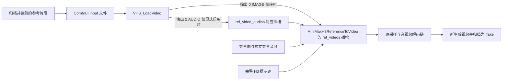

# Freyja 参考视频生成视频：功能与接入设计

设计日期：2026-10-23。来源对话：`01a16513-a143-73b1-827e-f47e5e61b8f3`。

原始需求：让 Freyja 平台可以使用参考视频生成视频；允许修改 ComfyGateway 与 ComfyUI 工作流；当前 ComfyUI 离线。

本文记录已落地的功能设计与部署契约。分镜素材、片段准备、输入快照、网关接线、前端及提示词入口已实现；代码与离线检查不代表 GPU 推理、模型效果或目标机器节点兼容性已经验证。在线能力默认保持 `UNVERIFIED`。部署与当前验证范围见第 11 节。

## 1. 功能决策

在现有 `REFERENCE_MODE` 中增加参考视频，与参考图、参考音频并列；继续使用 `TXT2VIDEO_REF` 模型类型。首期打通“选择视频 → 截取片段 → 编写参考意图 → 模型条件输入 → 生成新 Take”的完整链路。

用户可以参考动作、运镜、节奏、构图或明确指定的其他内容。参考意图由创作者明确填写，或由 AI 生成供创作者编辑；Java 仅透传与校验。不会通过关键词猜测意图，也不承诺逐帧复刻、精确动作迁移或确定性换人。

首期产品上限为 **1 段参考视频**，这是控制解码内存与推理成本的产品范围，不是宣称 H3 只能接收一段视频。视频时长、解码尺寸、帧数、混合素材总量等限制由经过验证的具体模型配置决定。

优先适配 `minimax-h3-ref-turbo8` 的基础生成链路；原版、Turbo4、人脸修复分别验收后开放。`FIRST_LAST_FRAME` 不接收本功能的视频输入；保留切换模式前的素材草稿，提交时发现不兼容素材应明确阻止，不能静默丢弃。

## 2. 当前实现与缺口

| 层级 | 已有事实 | 本功能需要补齐 |
| --- | --- | --- |
| 模型中心 | `AiModel.maxVideos`、`paramsJson`；管理页面已有最大参考视频数 | 经过验证的能力契约；不能仅凭 `maxVideos > 0` 显示为可用 |
| 分镜 | `DramaShot`、DTO/VO 有参考图与参考音频 | `refVideos` 的保存、读取、清空、来源解析与校验 |
| 上传 | `POST /res/asset/upload` 支持通用文件归档，已有 MP4/WebM MIME 处理 | 视频实测元数据、文件限制与片段处理；不能仅检查扩展名 |
| 视频源 | `VideoProcessSourceResolver` 支持 URL、当前视频、历史 Take | 复用来源校验，冻结本次输入版本 |
| 前端 | `ShotMultiModalRefRenderModal.vue`、`ShotVideoPickerDialog.vue` | 视频卡片、片段选择、能力提示与预检错误定位 |
| Java 调度 | `AiImageApiServiceImpl` 发送图片、音频结构化 `references` | 视频来源归档、片段预处理和视频 binding |
| 网关 | `ReferenceType.REFERENCE_VIDEO` 和 `ReferenceBinding.referenceVideo` 已定义 | 从 binding 收集视频、能力验证、有序上传与解码接线 |
| 网关通用视频 | `ImageGenerationRequest.video_url` 可上传；有 `mappings.video` 时注入 | 与“生成参考视频”分开，保留其后处理源视频语义 |
| H3 API 图 | `MiniMaxH3ReferenceToVideo`；handler 动态接入图片和音频 | 动态接入参考视频帧序列，不能只上传文件 |
| 历史与队列 | Take 有 `requestSnapshotJson`；批任务有 `Snapshot` | 入队即冻结视频输入，失败任务也能查到输入 |

关键依据：

- [网关请求模型](../comfy_gateway/schemas.py)、[参考绑定](../comfy_gateway/reference_prompt.py)、[上传与调度](../comfy_gateway/main.py)、[工作流装配](../comfy_gateway/workflow_engine.py)。
- [Java 视频请求组装](../src/main/java/com/astra/freyja/service/impl/AiImageApiServiceImpl.java)、[批任务预检](../src/main/java/com/astra/freyja/service/video/VideoBatchPreparation.java)、[来源解析](../src/main/java/com/astra/freyja/service/impl/VideoProcessSourceResolverImpl.java)。
- [Turbo8 UI 图](../comfyUI_workflow/video_minimax_h3_r2v_official_turbo8.json) 的节点 `136` 暴露 `ref_videos.ref_video_0: IMAGE`，连至节点 `147: VHS_LoadVideo` 的输出 `0`。当前本地文件中节点 `147` 为 `mode=2`，标题提示上传后启用，属于尚需验证的 UI 接线证据。
- 同一 UI 图暴露 `ref_video_audios.ref_video_audio_0: AUDIO`，目前未连接。旧 [Ref2VA UI 图](../comfyUI_workflow/minimax_h3_ref2va_fast.json) 还暴露第二个视频插槽；不能由此认定所有版本的实际限制相同。
- 对应 [Turbo8 API 图](../comfy_gateway/comfyUIApi/minimax_h3_ref2va_official_turbo8.json) 的节点 `136` 没有参考视频连接。现有 handler 不处理视频，因此 UI 图存在插槽不等于平台链路已经可用。

## 3. 用户流程

1. 打开参考模式渲染工坊，选择提供商与视频模型。
2. 在“参考视频”区域选择本地上传，或复用现有分镜/历史 Take 选择器。上传结果先归档至 MinIO；不把视频转成 Base64 放入前端状态或提示词。
3. 服务端探测真实时长、宽高、帧率、音轨与格式。卡片展示封面、来源分镜/Take、播放器和秒级片段范围。
4. 用户填写参考说明，例如“参考镜头推进速度与人物起身动作；人物外观使用 Picture 1”。该说明是创作要求，不是程序可保证的控制强度。
5. 选择是否使用该视频的原音作为生成条件，默认关闭。开启前检查模型能力及素材是否确实包含音轨。
6. 保存分镜，再预检并提交。成功结果进入原有渲染任务中心与 Take 历史，支持重选。

参考视频不要求同时选择图片。视频加独立参考音频应在模型允许时通过“音频不能是唯一参考模态”的检查；仅音频仍按原模型限制处理。无参考素材的原文生视频行为保持可用。

页面展示“目标生成时长”和“参考片段时长”两个数值；两者独立，不能因为选择 5 秒片段就偷偷修改分镜时长。调整素材顺序、片段或音轨选项后，提示词素材指纹失效，提示检查并重新生成或明确确认提示词。

切换到不支持视频的模型时保留草稿并展示原因，渲染按钮给出明确修复入口。未知能力显示“尚未验证”，节点离线显示“算力节点离线”；素材保存不依赖 GPU 在线。

## 4. 数据模型与输入契约

### 4.1 分镜持久化

新增 `ShotRefVideoDTO`，在 `DramaShotDTO/VO`、前端 `drama.d.ts` 增加 `refVideos`。沿用现有素材列表模式，在 `drama_shot` 增加可空 `ref_videos_json`，在 `drama_shot_video_take` 增加 `ref_videos_json`。

建议输入：

```json
{
  "refVideos": [
    {
      "id": "ref-video-1",
      "name": "起身动作参考",
      "sourceType": "SHOT_VIDEO_TAKE",
      "sourceShotId": "2032095628944588801",
      "sourceVideoTakeId": "2032095628944588802",
      "startSeconds": 1.25,
      "endSeconds": 5.25,
      "includeAudio": false,
      "referenceDescription": "参考动作节奏与推进运镜，人物外观采用 Picture 1。"
    }
  ]
}
```

规则：

- `DIRECT_URL` 必须提供 `sourceVideoUrl`，不得混传分镜/Take ID；上传到平台的视频也使用这一来源类型。
- `SHOT_CURRENT` 必须提供 `sourceShotId`；`SHOT_VIDEO_TAKE` 必须提供分镜和 Take ID，服务端验证归属与可用性。不信任客户端附带的解析 URL。
- `id` 为稳定素材标识；`Video 1` 是最终顺序标签。更改顺序后按规范化列表重新编号，不能按 URL 字典排序或异步上传完成顺序编号。
- `startSeconds` 缺省为 `0`；`endSeconds` 缺省为源视频结尾。服务端解析后验证 `0 <= start < end <= measuredDuration`；超过上限应要求用户修改，不能无提示截短。
- `includeAudio` 缺省为 `false`；`referenceDescription` 可空，建议最大 1000 字符；不从名称或说明推导其他隐含设置。
- 源时长、帧率、宽高、音轨等都是服务端实测返回字段，客户端数值不作为校验依据。
- 更新接口区分字段未提供与显式清空；推荐 `[]` 清空列表。旧数据 `NULL` 按空列表读取。
- 业务 ID 全程使用字符串；前端下拉 `key/value` 使用 `String(id)`，空 ID 清洗为 `undefined`。

### 4.2 渲染输入快照

新增 `ResolvedShotVideoReference`，记录稳定素材 ID、最终序号、来源类型、源分镜/Take ID、源 URL、归档对象键、源内容 SHA-256、片段范围、原始元数据、预处理配置版本、实际片段 URL/对象键、片段 SHA-256、音轨选项与参考说明。

分镜保存的是可编辑来源配置；**预检并接受任务时**冻结实际视频版本。`SHOT_CURRENT` 在此时解析为特定 Take/URL，入队后不能在执行阶段重新查询“当前视频”。预检到最终提交之间若来源版本变化，应返回 409 要求重新预检。

直接 URL 即使字符串固定，字节也可能变化。提交接受前将源视频归档至平台生成的唯一 MinIO 对象键，并计算摘要；复用已有平台不可变对象时仍记录其内容摘要。片段产物使用唯一对象键且不覆盖。下载 URL 是运输地址，对象键与摘要才是持久身份；短期签名 URL 在任务执行时重新签发。

将规范化输入写入持久队列 `VideoBatchModels.Snapshot`，并给 `render_task` 增加可空 `request_snapshot_json`，保存版本化的完整请求摘要。成功 Take 同时保存 `refVideosJson` 与请求快照。失败或取消没有 Take，也可以从任务查看参考输入。

快照不保存 Base64、凭证或过期签名参数。重试复用原快照；用户主动“重新生成”创建新任务、重新预检。重复提交使用既有任务 ID 幂等机制，不能重复创建 Take。

## 5. 模型能力与接口

### 5.1 复用模型中心

继续使用 `AiModel.paramsJson.videoGeneration`，增加 `referenceVideo` 子对象。以下为结构示意，`null` 代表待实测补齐，不能以该配置开启生成：

```json
{
  "videoGeneration": {
    "referenceVideo": {
      "schemaVersion": 1,
      "status": "UNVERIFIED",
      "adapter": "MINIMAX_H3_REF_VIDEO_V1",
      "workflowRevision": null,
      "maxVideos": 1,
      "minClipSeconds": null,
      "maxClipSeconds": null,
      "maxTotalClipSeconds": null,
      "decodeFps": 24,
      "maxDecodedFrames": null,
      "maxDecodeWidth": null,
      "maxDecodeHeight": null,
      "maxMixedAssets": null,
      "supportsVideoAudio": false
    }
  }
}
```

`24` FPS 来自当前 H3 工程的采样设置，最终由具体工作流验收确认。其余帧数、时长、尺寸不能把 UI 示例的 120 帧或 768 宽直接当成模型官方上限。

新增同构的网关 `ModelConfig` 能力配置。Java 控制业务上限，网关声明实际接线和节点约束；不能把 Java 配置设成 true 就默认网关支持。有效数量取产品上限、`AiModel.maxVideos`、模型契约和网关契约的最小值；缺失关键限制、状态未验证或契约版本不一致时拒绝视频渲染。

能力状态建议为 `UNSUPPORTED / UNVERIFIED / VERIFIED`。只有对应工作流版本与目标节点验收后才能标记 `VERIFIED`；节点健康状态单独记录。旧模型没有新配置时视为本功能未启用，不影响其原有图片/音频业务。

建议新增接口：

| 接口 | 职责 |
| --- | --- |
| 网关 `GET /v1/models/{modelCode}/capabilities` | 返回参考视频契约、工作流版本、各节点验证与健康状态 |
| Java `GET /drama/shot/video-model-options?providerId=...` | 返回合并后的模型能力与不可用原因，供渲染工坊使用 |
| Java `POST /drama/shot/{id}/video-reference-preflight` | 解析来源、实测元信息、校验模型限制，返回带过期时间和输入指纹的 `preflightId` |

继续复用 `POST /res/asset/upload`、`GET /video-processing/source-shots`、`POST /video-processing/probe-source` 和 `POST /drama/shot/{id}/render`。渲染请求新增 `preflightId`；服务端确认其属于当前分镜、模型与素材配置。没有视频输入的旧调用无需该字段。

预检结果与归档对象持久化，不能只存在进程内存。大视频归档和剪辑使用有超时及并发限制的准备任务，预检接口可返回 `PREPARING` 后轮询；完成前不占 GPU 渲染槽。输入指纹覆盖素材顺序、Take 版本、裁剪范围、音轨选项、说明、模型/工作流配置。批量预检按分镜返回结果。

### 5.2 Java 到网关的唯一视频参考表示

扩展现有 `references`，不增加与之竞争的 `ref_videos` URL 数组；`video_url` 保留为超分、补帧等操作的源视频字段。

```json
{
  "model": "minimax-h3-ref-turbo8",
  "prompt": "<经创作者确认的完整 H3 参考模式提示词>",
  "prompt_format": "MINIMAX_H3_REF2VA_VIDEO_V1",
  "size": "960x544",
  "duration": 5,
  "task_id": "RENDER_EXAMPLE_001",
  "shot_id": "2032095628944588801",
  "response_format": "url",
  "references": [
    {
      "referenceId": "ref-video-1",
      "referenceType": "REFERENCE_VIDEO",
      "entityId": "2032095628944588802",
      "referenceVideo": "https://media.example.test/refs/immutable-clip.mp4",
      "includeAudio": false,
      "contentSha256": "<片段内容摘要>",
      "referenceDescription": "参考动作节奏与推进运镜，人物外观采用 Picture 1。"
    }
  ]
}
```

新增 binding 字段 `includeAudio`、`contentSha256`；片段已由 Java 侧准备完成，网关不再次根据原视频起止时间剪辑。`entityId` 仅追溯来源，不作为视频字节解析入口。网关验证媒体摘要与探测结果符合契约。

旧逻辑会同时发送顶层和 `extra_body.references`；新逻辑以顶层为规范值，相同副本可接受，冲突返回 422，不得静默选择一份。网关从所有视频 binding 有序收集视频；H3 请求若混入 `video_url`，明确提示改用视频 binding，避免“上传成功但未参与生成”。后处理模型继续使用原字段。

现有 `/v1/videos/generations` 是工程内的兼容扩展协议；这些字段不宣称为所有 OpenAI 兼容服务通用。非 ComfyGateway 提供商须另有已验证适配契约才能启用。

## 6. Java 处理边界

建议新增 `ShotVideoReferenceService`，组合现有来源解析能力与 FFprobe/FFmpeg 服务；避免把整段视频处理继续堆入 `AiImageApiServiceImpl`。

处理顺序：请求结构与能力校验 → 来源归属校验 → 冻结来源版本 → 限额下载/归档 → FFprobe 实测 → 范围与成本校验 → FFmpeg 裁剪标准化 → 再探测 → 快照持久化 → 渲染入队。

片段处理使用秒级起止时间，并明确输出为 `[startSeconds, endSeconds)`；不得在可变帧率源上用 `秒数 × 原 FPS` 猜跳帧位置。通过重新编码获得可验证片段，检查实际时长与允许的帧级误差。

首期标准化为模型契约声明的容器、编码、帧率、像素格式和解码尺寸，保留宽高比；具体缩放/补边策略随预处理版本记录并在页面预览。不改变播放速度，不自动循环、延长或用片段长度覆盖目标输出时长。

源文件字节数、最大输入时长、下载与 FFmpeg 超时、并发数均配置化。未知格式、无视频轨、零帧、解码超限立即拒绝。复用现有 URL 安全校验并补全重定向目标检查；允许配置的 MinIO 内网地址，拒绝任意本地路径与非 HTTP(S) 源。处理临时文件使用任务隔离目录并在结束后清理。

独立参考音频与视频内音轨分开计量，均纳入模型总限制。默认不带视频原音；开启后只是额外生成条件，不会直接混进最终输出。没有音轨时返回明确错误。是否复制音乐由创作者显式决定，沿用系统对背景音乐的创作要求。

## 7. ComfyGateway 与工作流接线

### 7.1 新增视频处理链

`schemas.py` 提供 `get_all_ref_videos()`，只从合法 `REFERENCE_VIDEO` binding 收集，保留素材 ID 与顺序。不使用“相同 URL 自动去重”：同一源视频的不同片段或不同语义引用可能是不同素材；首期数量为一，仍保持可扩展结构。

`main.py` 在上传媒体前完成模型精确匹配、能力状态、数量、混合素材、目标节点版本验证。参考视频模型匹配不能走 `GatewayConfig.get_model()` 的部分名称回退；不存在的编码直接失败，防止新增名称误落到相似模型。

向选定节点上传准备好的片段。当前 `load_and_upload_media()` 通过 `/upload/image` 写入 ComfyUI input，文件名与 `overwrite=true` 有并发覆盖风险；本功能上传名必须带任务与素材唯一标识，并保留返回 `subfolder/name`，不能丢弃子目录。不同节点必须分别上传，不能复用其他机器的 input 文件名。

`WorkflowEngine.assemble_workflow()` 增加有序 `uploaded_ref_videos` 参数，单项包含稳定素材 ID、上传路径与音轨选项；`_apply_minimax_h3_ref2va()` 创建视频加载节点并连接到条件节点。

### 7.2 已有节点支持的候选接线

以下为本地现有 JSON 支持的候选图，插槽及运行行为仍须在线核对：



以条件节点 `136` 为例，候选 API 片段：

```json
{
  "136_ref_vid_0": {
    "class_type": "VHS_LoadVideo",
    "inputs": {
      "video": "<该节点返回的 input 相对路径>",
      "force_rate": 24,
      "custom_width": 0,
      "custom_height": 0,
      "frame_load_cap": 0,
      "skip_first_frames": 0,
      "select_every_nth": 1,
      "format": "None"
    }
  }
}
```

把 `136.inputs["ref_videos.ref_video_0"]` 指向 `["136_ref_vid_0", 0]`。仅当能力允许且用户开启原音参考时，把 `ref_video_audios.ref_video_audio_0` 指向 `["136_ref_vid_0", 2]`。

这里 `frame_load_cap=0` 表示不二次截断已通过限额检查的片段，不能作为处理任意大视频的配置。`format="None"` 来自当前 UI 视频加载节点，需用目标版本 `/object_info` 确认枚举与输出类型。若节点版本不兼容，应换成经验证的加载/转换链，不能臆造节点类或插槽。

输出 H3 帧数继续沿用现有对齐逻辑；**输出视频帧数的 `(frames - 5) % 17 == 0` 规则不自动套到参考视频帧序列**。参考帧的要求由条件节点和模型单独验证。

### 7.3 装配约束

- 根据明确的 `handler_config` 配置条件节点、视频插槽前缀、加载节点类与输出索引；新能力路径遇到缺失节点直接失败，不猜节点 ID。
- 装配前清理所有旧 `ref_videos.*`、`ref_video_audios.*` 和本 handler 生成的加载节点；不能残留示例视频或上一任务素材。
- 有视频输入却无法连到实际条件节点时失败。不能只检查文件名出现在 JSON 中；验证从视频帧输出到条件节点再到采样与输出节点的路径。
- 当前 `_set_nested_value()` 可创建不存在的路径；新视频映射须先验证模板节点与字段存在，禁止悄悄造出无效节点字典。
- 禁止 `extra_body` 覆盖已经验证的视频绑定、加载路径、帧数限制或固定 Turbo 采样步骤。原 4/8 步与对应 LoRA 约束保持原契约。
- 无视频输入时不创建加载节点、不保留视频槽位，不要求额外视频插件；原图片、音频流程继续运行。
- 首期不启用人脸修复模型的视频能力。二阶段是否需要再次条件化必须单独评估和验收，不能直接复制到第二阶段或默认支持。

## 8. 提示词、队列与其他入口同步

H3 参考模式维持六段式结构，为视频新增稳定 `Video 1` 标签，明确每段视频需要保留的内容，以及与 `Picture N`、`Audio N` 的对应关系。具体可识别语法须结合目标节点实际编码逻辑和效果验收确认。

`MINIMAX_H3_REF2VA_VIDEO_V1` 为新增格式版本，避免现有提示词解析/校验器把视频说明丢弃。Java 只验证结构、编号和素材一致性；提示词语义由 AI/创作者给出，网关不临时追加一段未经确认的自然语言。缺少视频语义说明时保留为空并提示补充，不能从视频文件名推断。

必须同步 `ShotAiVisualPlanServiceImpl`、提示词预览与解析流程、生产计划输入指纹、MCP 的字段白名单/读写/工具说明，以及平台内置 Skill 文档。素材新增、移除、重排、裁剪或音轨变更均纳入提示词和生产计划指纹。

`VideoBatchPreparation.prepare()` 的音频唯一模态校验从“没有图片”调整为“没有图片且没有有效视频”；单镜头、批量渲染与 MCP 走同一规范化校验。`fingerprint()` 增加 `maxVideos`、参考视频能力和工作流版本。

批量任务接受时冻结所有视频来源；不在首期增加“等待本批另一分镜尚未生成的视频”依赖。可用历史 Take 才能作为来源，避免未实现的依赖环。任务重启恢复、远程取消与断线取回沿用既有 task/shot/prompt 关联。

新设计的错误应带 `code`、`referenceId`、`field` 与中文原因，便于定位卡片：`REFERENCE_VIDEO_UNSUPPORTED`、`REFERENCE_VIDEO_UNVERIFIED`、`REFERENCE_VIDEO_LIMIT_EXCEEDED`、`REFERENCE_VIDEO_SOURCE_CHANGED`、`REFERENCE_VIDEO_DECODE_FAILED`、`REFERENCE_VIDEO_WORKFLOW_MISMATCH`。节点离线单独使用 `COMPUTE_NODE_OFFLINE`，不与输入参数错误混淆。

## 9. 数据迁移与实施清单

迁移仅新增可空字段，不修改已有 `maxVideos` 的含义，不自动给旧模型开启视频能力。迁移脚本、根初始化 SQL 与 Docker MySQL 初始化 SQL 保持一致。任务快照增加 `schemaVersion`，旧任务无视频字段按空列表兼容。

| 阶段 | 具体变更 | 完成条件 |
| --- | --- | --- |
| A：输入与快照 | 新 DTO/VO、三个表字段、来源解析组合服务、预检存储和 FFmpeg 准备任务 | 离线可保存、实测、归档片段并冻结版本 |
| B：模型契约 | 模型能力 VO、网关配置/能力端点、精确模型路由、状态与版本校验 | 未验证能力无法发送视频渲染请求 |
| C：网关装配 | 视频 binding、唯一上传路径、handler 接线、严格图校验 | mock 下验证帧序列到条件节点的实际连接 |
| D：创作界面 | 参考视频卡片、来源选择器复用、范围预览、音轨选项、错误定位 | 上传/选择/保存/预检可完成；离线原因准确显示 |
| E：全入口一致 | 批任务、Take 历史、提示词服务、生产计划、MCP 与 Skill 同步 | 同一输入经各入口得到一致快照与限制判断 |
| F：在线验收 | 真实节点信息、UI/API 图一致性、GPU 小样、效果对照 | 指定节点和工作流版本可标记 VERIFIED |

主要修改文件包括：

- Java：`entity/DramaShot`、`DramaShotVideoTake`、`RenderTask`；`dto/drama/DramaShotDTO`、`DramaShotVO`、`DramaShotRenderRequestDTO`；新增 `ShotRefVideoDTO`、`ResolvedShotVideoReference` 与服务；`DramaShotServiceImpl`、`AiImageApiServiceImpl`、`ShotVideoTakeServiceImpl`、`VideoBatchModels`、`VideoBatchPreparation` 和相关控制器。
- 前端：`front/src/types/drama.d.ts`、`api/drama.ts`、`ShotMultiModalRefRenderModal.vue`、`ShotDrawer.vue`、`ShotVideoHistoryDrawer.vue`、提示词与批量预检界面；视频选择复用 `ShotVideoPickerDialog.vue`，参考视频卡片建议单独组件。
- 网关：`schemas.py`、`reference_prompt.py`、`main.py`、`config.py`、`workflow_engine.py`、节点 YAML、对应 `comfyUIApi/` API 图；开发者私有节点配置按实际部署同步。
- 文档与入口：资源/分镜/模型 API 文档、工作流 README、MCP schema/records、生产计划与提示词校验、内置平台指引与 H3 参考模式 Skill。

## 10. 离线验证与在线验收

### 10.1 ComfyUI 离线期间

以下为实施后的必测项，本文尚未运行这些新增功能测试：

- Java：来源互斥与 Take 归属、19 位 ID、空列表清除；实测元信息不能被客户端覆盖；非法范围、无音轨、超限与坏视频；预检后当前 Take 变化返回 409；入队后来源切换不改变任务；直接 URL 字节变更不污染已归档快照；失败任务保留输入。
- FFmpeg 本地夹具：恒定/可变帧率、无音轨/有音轨、短片段与边界裁剪；验证实际长度、帧数、宽高比与播放速度，不要求 GPU。
- 网关：从结构化视频 binding 解析并有序传入 handler；不支持/未验证/错版本在上传前失败；视频实际连至 `ref_videos` 的 IMAGE 输入；原音只在开启时接 AUDIO；空输入清理样例；顶层与 extra_body 冲突；并发同名素材不覆盖；未知模型不部分匹配；跨任务不污染模板缓存。
- 工作流静态检查：API 图为合法 JSON，映射目标存在，链接源节点存在，视频帧到条件节点及最终输出路径可达；UI 图的 mode、链接与导出 API 图接线一致。
- 前端：按项目约定执行 `npm run build`；人工检查选择器、裁剪预览、空值保存、字符串 ID、模型切换提示和服务离线提示。
- Java 使用 JDK 26 与 Maven wrapper 运行相关单测；网关沿用 unittest 风格扩展 `test_minimax_h3_workflows.py`，回归已有图片、音频、首尾帧、超分/补帧和任务恢复测试。

离线测试只能证明输入、校验和工作流装配契约，不能证明目标机器安装了所需插件、权重支持该输入或参考效果达标。

### 10.2 ComfyUI 恢复后

1. 获取目标节点 `/object_info`，核对 `MiniMaxH3ReferenceToVideo` 的动态视频/音轨槽、`VHS_LoadVideo` 的参数与输出索引，记录 ComfyUI/VHS 版本、权重与 LoRA 版本。
2. 在 UI 中启用视频加载节点，用短片段验证真实参考视频输入，重新导出 API 图；不能把 UI 的 muted/bypass 状态当成 API 执行语义。
3. 从最低已批准规格开始，分别验证“仅视频”“图片加视频”“视频加独立音频”“视频原音开启/关闭”和无参考回归。记录时间、内存/显存峰值、实际时长及错误。
4. 用明显不同动作/运镜的 A/B 视频，保持提示词、种子、输出参数与其他素材一致，再增加无视频基线；进行多次对照，人工判断所声明的参考内容是否影响生成。工作流出现视频文件名、任务成功或单次输出有差异都不足以单独证明参考效果。
5. 验证任务取消、断线恢复、历史 Take 重选以及并发素材隔离。对于模型不支持或实际无效的参考用途，应缩小能力声明，不能仅为开放按钮标记成功。
6. 将验证结果绑定模型编码、节点与工作流 revision，填写实测限制，再标记 `VERIFIED`。其他入口与人脸修复版本保持待验证，直至分别完成验收。

最终交付标准：用户能从平台选中明确的视频版本和片段，保存创作意图，看到准确限制，将真实帧序列送入经过验证的模型条件输入，并在任务及 Take 中追溯当次输入。ComfyUI 离线时允许完成素材准备与设计开发，生成能力是否可用以在线验收结果为准。

## 11. 已实现接口、部署与启用

### 11.1 数据库与运行环境

现有数据库在启动新版本前执行一次 [reference-video-generation.sql](../src/main/resources/sql/reference-video-generation.sql)。脚本为分镜、Take、任务添加快照字段，并建立持久化预检表。本次代码实现没有连接或修改已有业务数据库。新安装的根初始化 SQL 与 Docker 初始化 SQL 已包含这些字段与表。

Java 与网关都需要 FFprobe；Java 还使用 FFmpeg 生成 H.264、固定帧率的片段。网关 Docker 镜像已加入 FFmpeg 软件包。本地 Java 沿用 `freyja.media-tools.ffmpeg-path/ffprobe-path`，网关通过 PATH 或 `FFPROBE_PATH` 查找 FFprobe。

Java 的 `freyja.reference-video` 默认准备限制为：源文件 256 MiB、源时长 600 秒、片段文件 128 MiB、片段 15 秒、24 FPS、最多 360 帧、宽高各不超过 768 像素；准备和下载超时 120 秒，预检有效期 30 分钟。这些是产品准备预算，不是模型的官方能力声明；最终生成仍取已验证模型与网关限制的交集。

源视频使用有字节数限制的文件流读取；已配置的 MinIO URL 通过内部 SDK 读取，避免 Docker 后端尝试连接浏览器外部域名。原始归档和片段都使用唯一对象键；队列快照不保存临时签名 URL，执行时重新生成读取授权。

网关环境变量 `REFERENCE_MEDIA_HOSTS` 必须列出允许提供参考片段的主机名，逗号分隔。Docker Compose 默认值为 `minio`，与后端内部 MinIO 端点一致；本地运行按实际归档端点设置，例如 `127.0.0.1`。每次 HTTP 重定向仍需满足此限制。

### 11.2 实际接口

| 方法与路径 | 行为 |
| --- | --- |
| `GET /drama/shot/video-model-options?providerId=...` | 合并平台与网关能力，返回是否可生成、原因与限制 |
| `POST /drama/shot/{id}/video-reference-probe` | 接收单个 `ShotRefVideoDTO`，按来源解析并限额探测真实元信息；不使用旧后处理接口的整段内存下载 |
| `POST /drama/shot/{id}/video-reference-preflight` | 接收 `providerId/workflowTemplateId`，对已保存的 `refVideos` 异步归档、裁剪与校验 |
| `GET /drama/shot/{id}/video-reference-preflight/{preflightId}` | 返回 `PREPARING / READY / FAILED / EXPIRED`、错误、片段快照与预览地址 |
| `POST /drama/shot/{id}/render` | 携带 `preflightId`；服务端重新比对来源和能力，再固定输入入队 |
| `GET /v1/models/{modelCode}/capabilities` | 网关返回精确模型编码对应的契约、节点健康状态及工作流 revision；可用 `node_id` 指定节点 |

`READY` 表示素材已经准备完成，不代表模型已经验收。未验证或离线模型仍可准备素材；生成按钮依据模型状态阻止提交。预检记录持久化，已完成的预检可在应用重启后使用至到期；进程中断的准备任务可重新发起，未完成记录到期后返回 `EXPIRED`。

批量渲染复用同一份已完成且匹配来源的预检。请先在各分镜参考渲染工坊完成准备，再执行批量预检；首期不添加本批尚未生成视频的跨分镜依赖。原始输入重试使用队列快照，不重新读取来源分镜的当前视频。

### 11.3 在线验收后的能力配置

默认仅在 `minimax-h3-ref-turbo8` 登记待验证适配。节点私有 YAML 会覆盖默认节点配置：部署使用 `machine_local.yaml` 时，应在该文件的对应模型维护 `reference_video`，不能只改 `machine_default.yaml`。

完成第 10.2 节的节点与短片段验证后，填写网关 `reference_video` 的实测范围：

```yaml
reference_video:
  schema_version: 1
  status: UNVERIFIED
  adapter: MINIMAX_H3_REF_VIDEO_V1
  max_videos: 1
  min_clip_seconds: null
  max_clip_seconds: null
  max_total_clip_seconds: null
  decode_fps: 24
  max_decoded_frames: null
  max_decode_width: null
  max_decode_height: null
  max_mixed_assets: null
  supports_video_audio: false
  condition_node_id: "136"
  output_node_ids: ["130"]
  verified_backend: null
  verified_revision: null
```

上面的 `null` 必须由实测值替换。先保持 `UNVERIFIED` 填好限制并重启网关，从 capabilities 读取 `workflowRevision`。验收记录确认后，将 `verified_backend` 设为实际节点 `http_url`，`verified_revision` 设为该 revision，再设置网关状态。工作流、适配代码、映射或实测限制变更会改变 revision；切换后端地址也会使旧验收失效。

平台模型中心设置 `maxVideos=1`，在已有 `paramsJson.videoGeneration` 中合并第 5.1 节的 `referenceVideo` 子对象：使用相同的 adapter、`workflowRevision` 和实测限制。平台配置也须明确为 `VERIFIED`，且网关报告同版本已验收、节点健康时，生成入口才会启用。不要替换原有比例、尺寸与时长配置。可先在验收环境验证网关 API，平台生成入口保持未验证，完成联调后再启用平台配置。

### 11.4 指引与验证边界

MCP 分镜读写 Schema、平台系统指引、生产计划指纹、提示词 Manifest 与解析器已包含视频引用。内置 `freyja-platform-guide` 新增 [视频参考说明](../skills/freyja-platform-guide/references/reference-video.md)，ZIP 与 manifest 同步。已有数据库中的已发布 Skill 不会被启动初始化器自动覆盖，可通过技能管理导入新包并发布。

离线验证覆盖工作流连通、能力门禁、内容摘要、唯一上传路径、来源版本变化、预检持久化、MCP 字段类型，以及真实 FFmpeg 裁剪、帧数与音轨处理。实际 GPU 生成、模型参考效果、目标节点动态槽兼容性仍等待 ComfyUI 在线验收；当前配置没有将这些能力标记为已验证。

2026-10-23 验证结果：JDK 26 + Maven wrapper 运行 150 项相关 Java 测试，失败/错误/跳过均为 0；网关 44 项离线与异步回归全部通过；前端 `npm run build`（含 Vue/TypeScript 检查）通过。此次同时修复了 websockets 新版异常导入兼容问题，并清理旧 H3 模板未使用的示例加载节点；旧节点编号断言已改为检查实际素材连线。

### 11.5 分镜编辑与 AI 提示词入口

分镜编辑页切换到「多模态参考（图片 / 视频 / 音频）」后，即使尚未添加视频，也直接展示参考视频编辑器，支持上传、选择当前短剧分镜或历史 Take、设置片段范围、预览与填写参考说明。可保存配置，或保存后进入渲染工坊选择模型并预检；模型未验证不会隐藏编辑入口。

AI 提示词生成弹窗在多模态参考模式下也可直接编辑同一类视频草稿。API 自动生成和外部 AI 任务包均携带视频来源、片段范围、原音设置和明确的参考说明，生成 `<Video 1>` 引用；当前提示词推理不自动识别视频内容，创作者需要说明希望参考的动作、运镜或其他内容。采纳时，视频引用与提示词、图片、音频一并回填并保存；清空视频会显式提交空列表。生成后修改视频来源、范围、原音或说明会标记结果已过期，外部 AI 任务包也需重新导出。视频实际解码并作为模型条件输入发生在后续渲染阶段。
