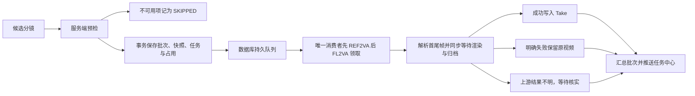

# 分镜视频批量提交渲染设计

> 状态：已按下述核心流程实现，实际接口、迁移及恢复方式见 [批量视频渲染 API](video-render-batch-api.md)。设计基于 2026-10-15 代码，实施于 2026-10-16。
> 默认场景：从剧作工作台打开独立弹窗，按全选、剧集、场景、镜头组或单镜选择分镜，批量提交视频生成。

## 1. 产品目标与首版边界

让创作者一次完成“选择分镜 → 检查准备情况 → 选择视频模型 → 提交后台队列 → 查看结果与处理失败项”，关闭弹窗、切换页面和刷新浏览器均不影响任务。

首版支持：

- 在独立弹窗内勾选多个分镜，支持当前短剧全选，以及按剧集、场景、镜头组批量勾选；一个批次限同一短剧，可跨剧集与场次。
- 混合提交 `FIRST_LAST_FRAME`（FL2VA）与 `REFERENCE_MODE`（REF2VA），两种模式分别指定提供商和渲染模型；画面比例为批次级唯一配置，所有分镜共用。
- 批次内部先串行渲染全部 REF2VA，再串行渲染全部 FL2VA；每种模式内部按剧作顺序执行。
- 默认只生成没有当前视频的分镜；可显式切换为“为已完成分镜再生成一个版本”。每镜每批生成一个 Take。
- 提交前逐镜预检，仅提交可用项，保留不可用项的原因。
- FL2VA 增加两个独立开关：“自动使用上一镜视频尾帧作为首帧”“自动使用下一镜视频首帧作为尾帧”。开关只控制缺失帧的自动补充，已配置首尾帧优先。
- 上一镜属于本批较早执行的任务时等待并使用其结果；下一镜已经在 REF2VA 阶段生成时可使用其新视频首帧。未产生来源视频时允许不传对应帧，不额外生成图片。
- Java 端统一串行处理分镜视频渲染，同一时间只提交并等待一个视频任务；当前任务结束后才执行下一项，不为每镜创建异步线程。
- 任务中心展示批次总体进度、当前分镜和逐镜结果，支持逐镜定位、统一取消整个批次、人工重试已确认失败项。
- 取消批次时已成功视频及 Take 保留，当前渲染立即请求中断，所有未渲染项一并取消，不再提交；不提供“只取消排队项、让当前镜继续”的取消模式。

首版不增加自动生图补图、AI 提示词生成、每镜多次抽卡、视频拼接或 Agent 渲染工具。自动首尾帧通过邻镜视频按需抽帧实现，不调用生图模型。

首版每批最多 200 镜。所有批次及单镜分镜视频提交共用一个全局队列，无论提供商和模型是否相同，同时在途的视频生成任务最多为 1。该数量固定为 1，不提供并发数设置。图片生成、AI 文本任务和独立视频后处理不在本次分镜视频队列的改造范围内。

## 2. 与现有代码的衔接

| 现状 | 设计决策 |
| --- | --- |
| `POST /drama/shot/{id}/render` 已支持单镜异步提交 | 抽取并复用输入解析、执行与完成逻辑，批次负责组织和调度 |
| `render_task` 已记录单次视频任务；`drama_shot_video_take` 管理成功版本 | 每个可提交项创建一个 `SHOT_VIDEO` 任务，成功仍写 Take，不另建视频历史体系 |
| 任务中心使用 `/ws/task-center` 与 `RENDER_EVENT` | 扩充批次摘要和关联字段，继续使用同一连接 |
| 原 `GROUP_SERIAL` 仅兼容历史数据，旧批渲染入口已移除 | 新建批次领域，全局单消费者在批次内先 REF2VA、后 FL2VA，帧来源有明确记录 |
| `ShotFrameContinuityService` 已实现同组上一镜尾帧、下一镜首帧提取 | 抽取接受固定来源视频的无绑定首/尾帧操作，按版本缓存，避免自动引用覆盖分镜手动配置 |
| H3 网关已有 0 张图片的纯视频生成路径 | 首帧缺失允许省略；首尾帧角色必须显式保留，不能把仅有的一张尾帧按列表位置误接为首帧 |
| 单镜任务 ID 为 `RENDER_` + 毫秒时间戳 | 改为 `RENDER_` + 雪花 ID，并保留数据库唯一约束，避免同毫秒批量创建冲突 |
| 当前请求冻结了 Prompt / seed，但执行时重新查询分镜 | 改为执行完整持久化输入快照，排队后修改分镜不改变本次任务 |
| 单镜视频当前通过 `renderAsyncExecutor` 派发 | 单镜和批量视频均改为仅持久化入队，由同一个串行消费者同步执行完整视频流程；不再向线程池批量投递视频任务，图片任务维持原执行器 |
| Take 自动选用依赖 `latestTaskId` | 单镜和批量共用分镜占用与条件更新，沿用最新任务保护；失败、取消保留原视频 |

当前 `ShotProductionPlan` 的准备状态可作为提示来源，不能仅凭缓存 `READY` 放行。批量预检仍检查实际分镜输入；手动准备且没有 ProductionPlan 的分镜同样可提交。

## 3. 页面与交互

### 3.1 工作台入口

在 `StoryboardGrid.vue` 顶部加入“批量渲染”，点击直接打开独立弹窗，选择与提交都在弹窗内完成。打开时可定位当前场景，默认不自动勾选分镜；从镜头组快捷入口打开时可以预选该组，并明确展示。

左侧为“当前短剧 → 剧集 → 场景 → 镜头组 → 分镜”复选树，父节点支持全选、取消和半选。顶部“全选”选择当前短剧所有分镜；同时支持单独勾选若干剧集、场景、镜头组及散选分镜，混合选择去重。取消某个父节点时移除该节点内的选择，其他节点选择保留。

全选和父节点选择均由后端展开完整候选，不能只选择当前页或已加载节点。筛选只影响展示，不隐式取消隐藏项；明确显示已选总数。超过 200 镜时提示缩小范围，不静默截断。全选只确定候选范围，默认跳过已有视频仍在预检中单独统计。

### 3.2 批量提交弹窗

建议宽度 1200px，左侧为选择树，右侧为配置和预检表，底部固定汇总与提交按钮：

1. **选择与生成设置**：复选树、全选 / 清空、批次名称、生成对象（默认“仅缺少当前视频”；可选“全部，再生成一个版本”），以及唯一的画面比例选择器。
2. **按模式配置**：REF2VA 与 FL2VA 分别选择提供商和视频模型；FL2VA 配置区额外展示两个自动取帧开关。没有该模式候选时对应区置灰，不要求填写。时长和种子沿用每镜已保存值。
3. **逐镜检查表**：剧集 / 场次 / 镜号、模式、执行阶段及顺序、首尾帧来源、其他素材概况、时长、模型、是否已有视频、检查结果、问题处理入口。

模型选项来自模型中心的启用配置，`FIRST_LAST_FRAME` 仅列 `TXT2VIDEO_FIRST_LAST`，`REFERENCE_MODE` 仅列 `TXT2VIDEO_REF`。本次涉及的两种模式必须分别明确指定模型，不能用一个模型覆盖两种模式，也不在执行时重新挑选默认模型。改变模型、批次画面比例或取帧开关后重新预检。

画面比例只在批次顶部设置一次，默认推荐短剧比例，支持已有画幅预设（如 16:9、9:16、1:1）。服务端按同一比例和所选模型的明确尺寸规则，解析并展示两种模式各自的实际输出尺寸；尺寸对齐可能使像素比接近预设。默认复用现有视频画幅映射，例如 16:9 对应 960x544、9:16 对应 544x960；实际尺寸必须对所选模型有效。不提供每种模式独立比例或独立尺寸输入；模型不支持当前统一比例时提示重新选择模型或比例，不静默改画幅。

FL2VA 两个开关互相独立，批次内所有 FL2VA 镜头共用：

- `autoUsePreviousVideoTailAsFirstFrame`：自动使用上一镜视频尾帧作为首帧，默认开启，延续此前确认的首帧兜底行为。
- `autoUseNextVideoHeadAsLastFrame`：自动使用下一镜视频首帧作为尾帧，默认关闭；默认值为本方案约定，用户可在提交前开启。

关闭开关只禁止相应自动取帧，不清除已配置首尾帧。预检分别展示首帧与尾帧来源，包括“已配置 / 本批 REF2VA 结果 / 本批已先执行的 FL2VA 结果 / 已有视频 / 不使用”；依赖本批前序结果不属于缺素材。执行策略固定显示“REF2VA → FL2VA，串行渲染，同时 1 个”。

```text
批量视频渲染                                      已选 24 镜
[全选] [清空]       生成对象 ● 仅缺少当前视频 ○ 全部再生成
                   画面比例 [16:9]（整个批次统一）

选择分镜            阶段一 REF2VA 提供商 [网关 A] 模型 [REF2VA …]
☑ 第 1 集           阶段二 FL2VA  提供商 [网关 A] 模型 [FL2VA …]
                   FL2VA ☑ 上一镜视频尾帧作首帧 ☐ 下一镜视频首帧作尾帧
                   输出尺寸：REF2VA 960x544 / FL2VA 960x544
  ☑ 场景 1
    ☑ 镜头组 1      镜号        模式   首帧来源       尾帧来源  检查结果
      ☑ 分镜 1      E01/C01/S01 FL2VA 已配置首帧     已配置    可提交
      ☑ 分镜 2      E01/C01/S02 FL2VA 上一镜尾帧     不使用    可提交
    ☑ 镜头组 2      E01/C01/S03 FL2VA 不使用         不使用    无图渲染
  ☑ 场景 2          E01/C02/S01 REF2VA 图片3 音频1    —         可提交
◩ 第 2 集           E02/C01/S01 REF2VA 缺少提示词     —         待补充

可提交 18 · 待补充 3 · 已有视频跳过 2 · 渲染中跳过 1
预计生成时长 162 秒；实际耗时由队列与算力决定
                              [关闭] [重新检查] [提交可用的 18 镜]
```

“预计生成时长”是输出视频时长之和，不是预计完成时间。界面说明“先完成 REF2VA 阶段，再执行 FL2VA；每阶段按分镜顺序逐个渲染”。没有可靠模型计价配置时不显示金额。

预检本身不修改分镜，也不产生 AI、图片或视频任务。没有可提交项时禁用提交。进入单镜编辑保存后返回弹窗，必须重新检查。

### 3.3 运行中批次

提交成功后返回批次 ID，提示“已加入串行渲染队列”，提供“前往任务中心”。任务中心是批次总体进度的主入口，工作台也可打开同一批次详情抽屉。关闭弹窗后队列继续执行。

- 任务中心父行：批次名称、排队 / 执行中 / 已结束、已处理 8/18、总体进度 44.4%、当前镜头及阶段；分开展示“REF2VA 已处理 a/A”“FL2VA 已处理 b/B”。详情展示成功、失败、渲染中及排队数量，并单独列出跳过原因。
- 列表：保留剧集与场次定位，展示阶段、进度、错误、视频预览、打开分镜及查看 Take。
- “取消任务”：统一取消整个批次。先禁止领取并取消所有未执行项，再立即对当前渲染发送网关取消并中断本地执行，不等待当前镜正常生成完毕；已成功视频、当前选用 Take 与历史版本均保留。
- “重试失败项”：选择已确认失败项重新生成预检和新批次，默认使用原输入快照；可切换“使用当前分镜配置”。
- “处理待核实项”：展示任务 ID、上游定位与故障阶段，支持核实后归档已生成产物或确认上游已停止，并记录处理依据。

不在首版加入暂停/恢复，也不保留单独的“停止后续”按钮。取消后若需重做未完成项，应显式创建新批次，原批次不自动恢复。

## 4. 预检与快照规则

### 4.1 逐镜检查

| 检查项 | 处理规则 |
| --- | --- |
| 归属与访问范围 | 分镜必须存在、未删除，且属于本次短剧及当前请求可访问范围；无权访问的 ID 拒绝请求，不泄露名称与素材 |
| 模式 | 必须明确为受支持枚举；空值提示创作者指定，不通过自然语言猜测 |
| Prompt | 复用 `ShotRenderPromptUtil` 的模式选择规则；为空则阻塞，不在批量提交时自动调用 `assembleShotPrompt` 补写 |
| 视频模型 | 校验提供商、模型启用状态、所属关系及模式匹配；选择失败直接反馈，不吞异常后继续排队 |
| FL2VA 首尾帧 | 各自按“已配置 → 对应开关开启且邻镜视频可用时自动取帧 → 不传该帧”解析；缺少首帧或尾帧本身不阻塞。预检记录取源时序，禁止等待排在当前任务之后的来源任务 |
| 多模态参考 | 复用结构化参考绑定和关键图角色校验；数量受模型能力限制；H3 音频单段 2～15 秒、总长≤15 秒且不可只提供音频 |
| 比例、尺寸与时长 | 批次只有一个必填 aspectRatio，两种模型分别校验相同比例及其明确解析尺寸；校验正数、时长范围、尺寸对齐及模型约束，不静默改画幅 |
| 种子 | 校验现有安全范围；缺失或无效提示修复。成功提交后冻结，不自动刷新 |
| 已有视频 | 默认按 `videoUrl` / 当前 Take 判断是否已有视频，不能只看 `renderStatus`；选择“全部”时允许创建新 Take |
| 活动任务 | 同一分镜有待执行、渲染中或上游结果待核实任务时跳过，避免跨批次与单镜重复占用 |
| 素材地址 | 预检校验结构、绑定及已知资产状态；执行前再次读取并验证媒体。已配置素材或选定来源视频读取/抽帧失败时单项失败，不把技术故障静默当作“没有视频” |

模型能力应有明确来源；现有配置缺少必需约束时，补充模型能力字段或经过定义的适配器配置，不能靠模型名称关键词推断。

返回逐镜 `READY / BLOCKED / SKIPPED`、稳定 `reasonCode`、可读原因和定位信息。首版允许将已展示的不可用项记为跳过，再提交可用项；这通过“提交可用的 N 镜”表达清楚。

### 4.2 预检与提交之间的一致性

预检返回后端展开的完整 `shotIds`、两阶段执行顺序和 `previewHash`。摘要覆盖候选 ID、影响渲染及跳过决策的字段、模型配置版本、统一画面比例、解析尺寸、两个 FL2VA 开关、逐镜检查结果，以及首尾帧来源计划、固定相邻关系和已有来源视频版本。本批尚未产生的视频只记录来源任务关系，不要求预检时已有视频。

提交携带相同候选 ID、选项和 `expectedPreviewHash`。后端重新检查；如果输入、活动任务或可提交集合发生变化，返回 `409 PREVIEW_STALE` 和变化项，整个提交不落库，界面重新检查。不能在用户已看到 18 镜后悄悄提交另外一组镜头。

提交事务按 ID 顺序锁定候选分镜与所需相邻来源快照记录，再检查占用及输入版本；不为未选中的来源镜头创建渲染任务。单镜提交也使用相同锁与占用协议。只有提交时仍符合预检的项目才进入批次，事务失败整体回滚。

### 4.3 FL2VA 两个自动取帧开关与来源解析

“上一镜 / 下一镜”是同一镜头组内按 `sortOrder → shotNo → id` 稳定排列的直接相邻分镜，指剧作顺序中的邻镜，不是上一条 / 下一条队列任务。沿用现有边界，不跨镜头组、场景或剧集，不跳过无视频邻镜去找更远的镜头。

两个方向独立解析，优先级一致：

| 目标输入 | 优先级 1：已配置 | 优先级 2：相应开关开启 | 无可用来源时 |
| --- | --- | --- | --- |
| 当前首帧 first_frame | 提交时的 previewImageUrl | 上一镜实际视频的尾帧 | 省略 first_frame |
| 当前尾帧 last_frame | 提交时的 endFrameImageUrl | 下一镜实际视频的首帧 | 省略 last_frame |

开关关闭时只使用已配置输入；未配置则不传该帧，禁止自动抽取对应方向的帧。已配置输入无论开关是否开启均保持最高优先级，读取失败时报单项错误，不能悄悄替换成邻镜帧。

**首帧来源（上一镜）**：

1. 上一镜属于本批 REF2VA 或排序更早的 FL2VA 实际渲染项：等待其结束后，成功则使用该任务产物的具体视频 URL / Take ID，不能改取后来手动选中的其他 Take。
2. 上一镜未在本批实际渲染（未选中、已有视频被跳过等）：使用提交时冻结的已有视频，不额外把上一镜加入渲染范围。
3. 本批来源任务明确失败或已确认取消：优先使用该来源提交时冻结的旧视频；没有旧视频则不传首帧。
4. 没有上一镜或来源没有视频：不传首帧，正常渲染。上游结果待核实时继续遵守全局停止派发规则，不将其视为明确失败。

**尾帧来源（下一镜）**：

1. 下一镜属于本批 REF2VA 实际渲染项：REF2VA 阶段已先执行，优先使用该任务成功产物的视频首帧；明确失败或取消时退回提交时旧视频，没有旧视频则不传尾帧。
2. 下一镜未在本批实际渲染：使用提交时冻结的已有视频；没有则不传尾帧。
3. 下一镜属于本批尚未执行的 FL2VA：只使用提交时冻结的旧视频；没有则不传尾帧。**不等待后面的 FL2VA，不调整为倒序，也不额外重渲染当前镜头。** 预检明确提示“下一镜尚未渲染，使用已有视频首帧”或“下一镜尚无视频，本镜不使用尾帧”。

该规则保证两个开关同时开启时不会出现“当前镜等待下一镜、下一镜又等待当前镜”的循环，仍严格满足全局一次只执行一个视频。先 REF2VA 后 FL2VA 让下一镜为 REF2VA 的场景可以使用本批新产物。

以上失败兜底仅适用于批次仍在正常执行时；一旦整个批次被取消，当前及剩余项全部停止，不通过无帧兜底继续生成后续镜头。

**缺少首帧、尾帧均为允许的输入状态。** 不调用生图、不擅自拿角色设定图补帧、不切换分镜模式。两个都没有时使用模型支持的无图生成路径；模型选项须明确支持最终输入组合，否则提示模型不兼容。

仅在当前待执行镜头需要自动输入时按需抽取邻镜首 / 尾帧，缓存键包含来源视频版本 / Take、首帧或尾帧类型及抽帧策略版本。自动取帧只写执行快照和 Take，不回写分镜 previewImageUrl / endFrameImageUrl；更新来源尾帧缓存时带来源视频版本条件。

现有手动继承接口会绑定当前分镜，部分抽帧接口仍读取来源当前视频。建议抽取 `resolveVideoFrame(sourceShotId, sourceVideoUrl, sourceTakeId, frameType)`（FIRST / LAST），只对固定来源版本抽帧；原单镜手动引用接口在外层继续负责绑定。

仅有尾帧而没有首帧时，网关必须保留 last_frame 的角色。现有部分 H3 工作流按上传数组第一个位置接首帧，需改为保留输入角色的映射，不能把尾帧前移或自动补成首帧。

### 4.4 不可变输入与延迟解析

每个可执行项持久化 `ShotVideoRenderSnapshot`，至少包含：

- 分镜及归属 ID、展示名称、模式、执行阶段、阶段内顺序、Prompt、negativePrompt、时长、seed、批次统一 aspectRatio 与该模型解析后的 size。
- 已配置首尾帧具体 URL；参考图/音频完整结构、顺序、用途、人物/造型与关键图角色等已解析绑定。
- 来源 Take ID、来源视频 URL、提供商 ID、模型 ID / code、端点配置版本、能力版本。
- 提交时当前 Take ID、输入摘要、快照版本与提交时间。
- 两个 FL2VA 自动取帧开关；独立的 firstFramePlan / lastFramePlan，包括 CONFIGURED / PRIOR_BATCH_RESULT / EXISTING_VIDEO / NONE、固定邻镜 ID、取 FIRST / LAST、来源批次项 ID、邻镜旧视频快照和无图原因。

已配置输入、邻镜关系、两阶段执行顺序和取帧策略在提交时冻结；允许依赖的本批前序任务尚无视频 URL，在轮到当前镜头时按其已结束的任务结果解析并抽帧，追加一次 resolvedInputSnapshot，分别记录实际首尾帧来源版本、图片 URL 或无图原因。依赖来源任务的 executionOrder 必须小于当前任务，预检及执行前均验证。外部生成请求使用完整执行快照，持久化后不再跟随当前分镜变化。

快照保存明确地址和对象键，不保存 Base64 大文件、API Key 或可解密凭据。自有媒体对象被活动任务引用期间应禁止删除；外部可变 URL 无法保证内容不变，需要严格复现时先转存为受管对象。

执行阶段从快照和固定来源任务结果构造请求，不重新解析当前分镜素材、镜头排序、当前 Take、默认提供商或默认模型。提供商被禁用、端点变更或模型删除时，在派发前失败并要求重新预检；凭据从当前安全配置读取。

## 5. 持久化与状态

### 5.1 表与关键约束

新增批次与项目表、分镜占用表及全局串行状态记录，扩展现有任务关联：

| 对象 | 关键字段与用途 |
| --- | --- |
| `video_render_batch` | `id`、`drama_id`、名称、创建主体、`client_request_id`、规范化请求摘要、唯一 aspect_ratio、两种模式模型配置、FL2VA 两开关、current_phase、cancel_requested / cancel_requested_at、生命周期、结果、总计数和分阶段计数、创建/完成时间、`retry_of_batch_id` |
| `video_render_batch_item` | `id`、`batch_id`、`shot_id`、render_phase、阶段内 order_no、全局 execution_order、状态、`render_task_id`、输入快照及 hash、独立 first_frame_plan / last_frame_plan、`resolved_input_snapshot`、跳过/失败原因、`failure_phase`、`outcome_certainty`、`retry_of_item_id` |
| `shot_video_render_slot` | `shot_id` 主键、持有 `task_id`、批次项 ID、占用时间；从排队开始独占，确认终态后释放，单镜和批量共用 |
| `video_render_dispatch_state` | 固定主键的全局单行，记录当前 `task_id`、工作实例、派发阶段及最后心跳；原子领取确保所有实例合计只有一个在途视频任务 |
| `render_task` 扩展 | 可空 `batch_id`、`batch_item_id`，保持 `SHOT_VIDEO` 类型；`task_id` 全局唯一，`batch_item_id` 非空时唯一 |

约束与索引：创建主体 + `client_request_id` 唯一；`batch_id + shot_id` 唯一；批次项索引覆盖 batch_id + execution_order 及待领取状态/排序；全局串行槽位与分镜占用使用事务和原子条件更新。来源计划分别记录来源项目与视频版本，允许首尾帧来自不同镜头。占用不靠 TTL 自动释放，上游未确认停止时禁止仅因时间到期而派发下一镜。

同一个 `clientRequestId` 携带同样规范化请求时返回原批次；请求内容不同返回 `409 IDEMPOTENCY_CONFLICT`。该幂等检查必须先于重新预检：响应丢失后重发不能因为原任务已经占用分镜而失败。

事务中创建批次、所有候选项（不可用项为 `SKIPPED`）、可执行项的渲染任务和分镜占用，设置可执行分镜的 `latestTaskId`。不在事务中请求外部模型或下载媒体。事务提交后再更新缓存和推送事件；唯一的后台消费者顺序读取持久化队列，不依赖浏览器或事件回调存续。

### 5.2 状态含义

批次生命周期与结果分开保存：

- 生命周期：`QUEUED / RUNNING / CANCELLING / FINISHED / NEEDS_REVIEW`。
- 完成结果：`SUCCESS / PARTIAL_FAILED / FAILED / CANCELLED`；未结束时为空。
- 批次项：`SKIPPED / QUEUED / DISPATCHING / RENDERING / SUCCESS / FAILED / CANCELLED / NEEDS_REVIEW`。

`DISPATCHING` 表示唯一消费者已领取该项，正在解析首尾帧、抽帧或提交上游；对应现有渲染任务可暂保持 `QUEUED` 并展示阶段。`RENDERING` 包括等待上游与归档；只有该项处理结束才领取下一项，其余项保持 `QUEUED`。排队项可展示“等待 REF2VA 阶段完成”或“等待前序 FL2VA 镜头”，不另开线程或并行依赖调度器，不伪造 GPU 的精确执行百分比。

批次 currentPhase 为 REF2VA / FL2VA / COMPLETED；阶段和生命周期分开。批次未取消且 REF2VA 接受项全部进入明确终态后切到 FL2VA；没有某种模式时跳过对应阶段，明确失败的 REF2VA 项不阻止下一阶段。批次一旦取消则不进入下一阶段；结果不明时仍停止全局派发，不越过阶段边界。



没有任何 READY 项时不创建批次。跳过项不创建渲染任务，不算失败。批次级主动取消优先记为 CANCELLED，保留已成功计数与视频，不把有成功产物的已取消批次显示为普通失败；若全部已完成则取消幂等返回原终态，不改写成取消。未主动取消时：全部成功为 SUCCESS，部分成功且有失败为 PARTIAL_FAILED，无成功且存在明确失败为 FAILED。上游结果仍待核实时保留待核实标记，暂停全局派发。

任务中心总体进度 = `(SUCCESS + FAILED + CANCELLED) / 实际接受数 × 100%`，同时显示“已处理 N/M”、当前 REF2VA / FL2VA 阶段及镜头；分别展示两阶段已处理数与各自总数。进入 FL2VA 阶段时总进度不归零。单镜有可信进度时另行展示。跳过项不进入分母，待核实不算完成；100% 表示批次处理完毕，结果另行标明是否全部成功。重复事件不能重复累加，计数可从项目状态重算。

## 6. 串行执行、取消与恢复

### 6.1 一个后台消费者，逐个执行

- MySQL 是队列与状态事实来源，Redis 继续负责活跃缓存；WebSocket 只通知，不承担任务存续。
- HTTP 提交只校验和入库，立即返回。后台使用一个专用串行消费者，既不按镜头创建线程，也不使用 `@Async`、并行流或 `CompletableFuture` 同时提交多个视频。
- 消费者每次只领取一个任务，同步完成“按模式解析本次输入 → FL2VA 必要时抽邻镜首尾帧 → 调用视频 API 并等待结果 → MinIO 归档 → 写 Take 和终态 → 更新任务中心”，随后才领取下一项。
- 不同批次按提交顺序执行，不抢占当前批次；REF2VA 优先级在批次内部生效。单镜请求按单项队列单元处理，同样不能绕过全局串行限制。
- 批次先分成 REF2VA 和 FL2VA 两组，再在各组内按剧集、场次、镜头组、分镜排序和 ID 排序，拼接生成固定 executionOrder。禁止仅按叙事顺序交错提交两种模式；更晚提交批次的 REF2VA 不插入当前批次 FL2VA 阶段。
- 邻镜关系始终按原剧作顺序冻结，不按两阶段重排后的队列顺序求上一镜或下一镜。FL2VA 首尾帧仅依赖本批排在自己之前的任务结果或提交时旧视频，不依赖后序 FL2VA 新结果。
- Java 使用专用单线程后台执行入口，不阻塞 HTTP 请求线程，也不占用现有多线程生图执行器；同一个消费者执行期间不安排重入。
- 全局串行状态行在事务中领取并持久化当前任务，避免多个应用实例各执行一个视频。后台重启后先核实旧在途任务；心跳过期不能直接清空槽位并重发。
- 明确失败后写终态并继续下一项；上游未确认结束时保持全局槽位并停止后续派发，确保不因超时误判而同时存在两个远端视频任务。

```text
原剧作顺序：S1(FL2VA) → S2(REF2VA) → S3(FL2VA) → S4(FL2VA) → S5(REF2VA)
实际执行顺序：
  阶段一：S2(REF2VA) 完成 → S5(REF2VA) 完成
  阶段二：S1(FL2VA) 完成 → S3(FL2VA) 完成 → S4(FL2VA) 完成

开启两个取帧开关且未手动配置时：
  S1 尾帧可取 S2 新视频首帧；S3 首帧可取 S2 新视频尾帧。
  S3 尾帧只取 S4 提交时旧视频首帧，没有则省略，不等待 S4。
  S4 首帧可取 S3 新视频尾帧，尾帧可取 S5 新视频首帧。
每一步均等待视频生成、归档及落库结束后才进入下一步。
```

“只运行一个”约束由 Java 队列保证，不依赖先将所有请求推给网关、再由网关内部排队。

### 6.2 取消与完成竞争

取消是整个批次的统一操作，按以下顺序处理：

1. 事务设置 cancelRequested 和生命周期 CANCELLING，立即禁止领取本批任何下一项（包括另一阶段）；将所有 QUEUED 项改为 CANCELLED，取消对应 render_task 并释放其分镜占用。
2. 对已领取但未跨过提交边界的 DISPATCHING 项设置取消标记并立即中断准备操作，生成调用前再次检查取消标记；已进入提交边界竞态的项按在途任务立即取消，不当作“未提交”而直接释放槽位。禁止把下一镜领取为新的生成任务。
3. 当前已在上游渲染时，立即按 taskId 调用网关精准取消，并中断当前任务的本地请求、抽帧或归档操作，不等待视频自然完成。取消入口直接发控制请求，不排在正在等待的视频消费者之后；不为逐镜渲染建立额外线程。
4. 已经提交完成事务的 SUCCESS 项、视频文件、当前视频指针及 Take 历史不变；FAILED / SKIPPED 等既有终态也不改写。只有当前未完成项和未执行项转为 CANCELLED。
5. 更新任务中心为“已取消；成功 X、取消 Y”，总体已处理计数保留。重复取消幂等；操作只影响该批次，不取消其他批次或独立任务。

使用原有 cancelUpstreamStatus 记录上游取消结论。无论上游是否响应，本地执行立即停止，且本批未执行项不会再渲染。生命周期在本地清理完成后由 CANCELLING 变为 FINISHED、结果为 CANCELLED；未确认上游时额外显示“上游停止待核实”，保留全局视频槽位和该在途分镜占用，不派发任何新视频，核实结束后释放。消费者捕获当前任务中断并清理任务上下文，避免一次取消导致后续其他批次永久无法执行。

成功、失败、取消的落库使用状态条件更新；视频 Take、当前视频选择和任务成功应在同一个本地完成事务中裁决，避免取消与完成同时发生时写出互相矛盾的状态。分镜失败/取消状态更新必须带 `latestTaskId` 条件，避免旧任务覆盖新任务。

成功继续调用 `ShotVideoTakeService`，但需接收完整执行快照，不从当前分镜补采字段。只有任务仍为最新时自动选为当前 Take；失败保留原视频和尾帧缓存，成功更换当前 Take 时沿用现有缓存失效规则。视频成功后不无条件抽帧，仅在轮到需要自动首尾帧的 FL2VA 项时，对其明确来源按需提取相应帧。

### 6.3 重启与不确定结果

当前网关可按 `task_id` 跟踪和取消，但尚无可依赖的持久化任务结果查询与提交幂等契约，因此不能承诺跨进程故障下远端“恰好执行一次”。

- 确定没有跨过提交边界的排队项可继续执行。
- 领取后、可能已提交上游的项目如果失去工作实例，标记 `NEEDS_REVIEW`，不自动重新生成。现有 `render_task` 可记 `FAILED`，配套结构化原因 `UPSTREAM_RESULT_UNKNOWN`；批次显示待核实，不当作普通失败一键重试。
- HTTP 超时、断网或网关 5xx 不能一概断定远端未执行；归入结果待核实，除非协议能明确证明未受理。
- 已取得视频但 MinIO 归档失败属于归档问题，应记录可恢复的上游产物定位，只重试归档。无法恢复产物时展示待核实，不再次调用生成接口掩盖问题。
- 后续网关若增加持久化 `task_id` 幂等受理、状态/结果查询，才启用自动对账与恢复；查询不到也必须区分“未受理”与“记录已丢失”。

人工重试创建新批次、新项目、新 `taskId`，关联原记录；默认不自动重试视频生成。待核实项需要先取得明确处理结论，才释放占用并允许新生成。

使用原快照重试时不重新读取当前分镜的 Prompt 和素材；已有完整执行快照时直接复用，其中首帧或尾帧为空也保持为空，不改取其他邻镜视频。原批次的统一比例、模型和两个开关保持不变；新批仍按 REF2VA → FL2VA 排序。尚未派发的原项目按固定来源计划解析，不把原本引用的旧任务偷偷改成重试后的新任务；想重新选择邻镜版本时使用 CURRENT_SHOT 重新预检。仍检查分镜存在、访问范围、活动占用、模型可用性与快照媒体。重试入口默认 CREATE_NEW_TAKE，避免分镜保留旧视频时被默认跳过规则排除。执行期间重新选择历史 Take 维持现有规则：最新渲染任务成功后仍可自动成为当前版本，界面应说明这一行为。

## 7. 建议接口

接口沿用 `R<T>` 响应封装。以下示例中的业务 ID 均为字符串。

| 接口 | 用途 |
| --- | --- |
| `GET /drama/video-render-batches/selection-tree` | 按 `dramaId` 获取剧集 / 场景 / 镜头组 / 分镜复选树，可按父节点加载；全选语义不受已加载节点限制 |
| `POST /drama/video-render-batches/preview` | 按范围展开并预检，校验两种模型、唯一画面比例及 FL2VA 两开关，返回候选、两阶段顺序、首尾帧来源、实际尺寸与 previewHash |
| `POST /drama/video-render-batches` | 幂等创建，完成持久化后立即返回批次 ID、接受/跳过数量，不等待渲染 |
| `GET /drama/video-render-batches` | 按短剧、剧集、状态分页查批次 |
| `GET /drama/video-render-batches/{batchId}` | 批次摘要、计数、生效配置、可用操作与修订号 |
| `GET /drama/video-render-batches/{batchId}/items` | 分页查项目，按状态筛选 |
| `POST /drama/video-render-batches/{batchId}/cancel` | 统一取消该批次当前及全部未执行项，保留已成功产物，无 mode 参数，重复调用幂等 |
| `POST /drama/video-render-batches/{batchId}/retry-preview` | 指定失败项目与 `ORIGINAL_SNAPSHOT / CURRENT_SHOT`，预检后通过普通创建接口创建关联的新批次 |
| `POST /drama/video-render-batches/{batchId}/items/{itemId}/reconcile` | 核实不确定结果；归档已有产物或记录上游已停止，条件更新状态与占用并保留审计依据，不触发重新生成 |

预检支持混合选择：`selection={include:[{type: ALL/EPISODE/SCENE/SHOT_GROUP/SHOT, id?: string}], excludeShotIds: string[]}`。`ALL` 表示当前 `dramaId` 的所有分镜；其他类型必带对应 ID。后端对 include 展开取并集、去重，再排除 excludeShotIds。取消父节点时需同步清除其显式子选项或展开为相应排除项，避免取消父节点后隐藏的子选择残留。创建提交预检展开的完整 `shotIds`，避免整集或全选在两次请求之间新增分镜时扩大选择范围。

```json
{
  "clientRequestId": "756750ef-bf18-4455-9b55-b9c71e4272cc",
  "dramaId": "2109214975269752834",
  "shotIds": ["2109214976012144641", "2109214976012144642"],
  "expectedPreviewHash": "sha256:...",
  "existingVideoPolicy": "SKIP",
  "aspectRatio": "16:9",
  "modeConfigs": {
    "REFERENCE_MODE": {
      "providerId": "2109214976012144600",
      "modelId": "2109214976012144602"
    },
    "FIRST_LAST_FRAME": {
      "providerId": "2109214976012144600",
      "modelId": "2109214976012144601",
      "autoUsePreviousVideoTailAsFirstFrame": true,
      "autoUseNextVideoHeadAsLastFrame": false
    }
  }
}
```

`existingVideoPolicy=SKIP / CREATE_NEW_TAKE`。前端不提供可覆写的业务 `taskId`；服务端生成唯一任务 ID，将选中的 `modelId` 固定解析为模型 code，适配现有 `workflowTemplateId`，不开放任意工作流 JSON。

aspectRatio 只在请求顶层出现一次且必填，不在 modeConfigs 内重复声明。服务端将其解析成各模型明确可执行的 size 并在预检中展示；执行时使用冻结值。两个自动取帧布尔字段仅属于 FIRST_LAST_FRAME 配置，显式 false 必须保留；默认上一镜取尾帧开启、下一镜取首帧关闭。执行顺序固定为 REF2VA_THEN_FL2VA_SERIAL，由服务端生成，不允许客户端自定义倒序或并发。

重试创建另携带 `retryOfBatchId` 与 `retryItems=[{sourceItemId, inputSource}]`。服务端按来源项目读取原快照或当前分镜，校验其与本次 `shotIds` 一致，禁止直接信任前端上传的旧快照；这些字段也纳入预检与幂等摘要。待核实处理沿用任务管理的操作权限，只接受有具体产物或停止依据的结论，不通过“租约已超时”推断上游停止。

任务中心增加 sourceType=VIDEO_RENDER_BATCH，活跃列表和历史列表均展示批次父行，可展开子任务；子任务保留 RENDER_TASK 查询。批次父行和所属子行的“取消任务”均调用批次取消接口，操作范围明确写为“取消整个批次”，不能通过子项入口只取消一镜后继续该批。原单项取消接口识别到 batchId 时也转入同一批次取消流程；独立单镜任务仍只取消自身。父行显示总镜数、已处理数、总体百分比、成功/失败/取消数、当前 REF2VA / FL2VA 阶段及其进度。每次阶段切换或单镜结束更新父行，刷新后仍可恢复，汇总不重复统计父子行。

通过现有 `/ws/task-center` 新增 `VIDEO_RENDER_BATCH_EVENT`，携带批次 ID、修订号、计数和变化项 ID；子任务进度继续使用 `RENDER_EVENT` 并附带批次 ID。前端丢弃旧修订事件，重连后 HTTP 拉取摘要和当前列表，不另开 WebSocket。新增接口的查询、取消、重试和推送沿用应用访问范围校验。

## 8. 落地拆分与验收

建议实现顺序：

1. 抽取 ShotVideoRenderPreparationService、双向首尾帧解析服务、固定来源抽帧能力和执行快照，统一校验、任务 ID、条件更新和 Take 完成事务；修正网关仅有尾帧时的角色保留。
2. 增加批次表、项目表、分镜占用和全局串行状态行及迁移，同步 Docker 初始化结构；实现预检、幂等创建、REF2VA → FL2VA 两阶段顺序与唯一消费者，移除视频绕过队列的线程池派发路径。
3. 增加 ShotVideoBatchRenderModal.vue 复选树、唯一画面比例、两种模型配置、FL2VA 两开关和双帧来源预检表；工作台按钮直接打开弹窗。
4. 接入任务中心总体及分阶段进度、批次详情和 WebSocket，完成统一整批取消、失败重试及恢复，更新 API 文档。批量能力不加入现有 MCP / Agent 工具目录。

必要验收用例：

- 弹窗支持当前短剧全选、多剧集、多场景、多镜头组与单镜混选；父子半选正确，范围交叠去重，未加载节点也能选中，筛选不丢失选择。
- 画面比例只有一个，REF2VA 与 FL2VA 模型分别必填；共享比例在两种模型下均通过校验，预检展示实际尺寸，模型不兼容时不静默改比例。
- 两阶段执行严格先全部 REF2VA 后全部 FL2VA；每阶段按剧作顺序，源邻镜按原剧作关系查找，不能误用队列的上一项或下一项。
- FL2VA 两开关的四种开关组合分别符合预期，REF2VA 不受其影响；显式 false 不被默认值覆盖；已配置首尾帧始终优先，不执行 AI 补写。
- 开启首帧自动引用时，上一镜同批前序任务使用其新视频尾帧；未选上一镜可引用旧视频且不额外渲染它。开关关闭且无配置时不传 first_frame。
- 开启尾帧自动引用时，下一镜为本批 REF2VA 可取新视频首帧；为后序 FL2VA 时仅取旧视频，没有旧视频则不传 last_frame，两个开关同时开启不死锁。
- 邻镜缺失、无视频或明确失败且无旧视频时省略相应帧；不跨镜头组搜索更远视频。批次已取消时不通过这些兜底规则继续后续镜头。
- 无首帧但有尾帧时，网关仅连接 last_frame，不把尾帧当首帧；两帧都没有时可正常走无图生成路径。
- 整集超过上限、跨项目 ID、无权访问 ID 均明确拒绝；19 位 ID 从选择到请求全程保持字符串。
- 预检后分镜输入或模型配置改变，提交返回 409，批次、占用和任务均不部分落库。
- 双击、请求超时后重发、两个标签页同时提交与单镜/批量竞争均不会重复占用同一分镜。
- 同毫秒大量创建任务无 ID 冲突；队列很长时 HTTP 提交仍快速返回，排队任务不丢失。
- 排队后修改 Prompt、素材、时长、种子、镜头顺序、当前 Take 或默认模型，本次执行及 Take 仍使用固定输入和来源任务结果。
- 通过上游请求开始/结束记录验证：单批、多批、多提供商、单镜混合提交以及多实例部署时，同时在途视频任务始终最多 1；归档完成前不提交下一项。
- 已确认失败不阻塞后续项目；请求超时且上游结果不明时全局队列停止派发，不能把请求中断当作释放串行槽位的依据。
- 统一取消批次时保留已成功视频及 Take，立即发出当前任务取消并中断本地执行，全部排队项标记取消、不进入下一阶段；无仅取消排队的模式。
- 批次父行、所属子行及原单项接口发起取消均取消整个所属批次；独立单镜取消不影响其他批次。取消与完成竞争时原子裁决，已提交成功的产物不删除。
- 取消响应后当前本地执行停止且不会继续该批；上游停止未确认时显示待核实，不直接释放全局槽位或派发新视频。
- 任务中心展示总体及 REF2VA / FL2VA 分阶段进度、当前镜头和逐镜结果，阶段切换总进度不归零；取消批次显示成功与取消数量。刷新、断线、重复事件不丢任务或重复计数，重启先核实在途任务，已取消批次不恢复执行。
- 视频已生成但归档失败时重试归档；普通重试只处理明确失败项，成功项不重做。
- 成功记录 Take，最新任务可成为当前版本；失败与取消保留旧视频，仅在待执行 FL2VA 项需要首尾帧时按需抽邻镜视频帧，不无条件抽帧，也不回写手动帧配置。

实施说明：已落地全局单消费者、批次弹窗、两阶段顺序、首尾帧开关、统一比例、整批取消和任务中心。单镜提交创建单项批次；多实例互斥使用 MySQL 会话锁及持久化槽位。实际 WebSocket 复用 TASK_UPDATED，不新增连接或事件通道；重试复用 preview/create，人工核实与归档恢复接口以 API 文档为准。未自动执行现有数据库迁移，也未提交真实生图或视频生成请求。
