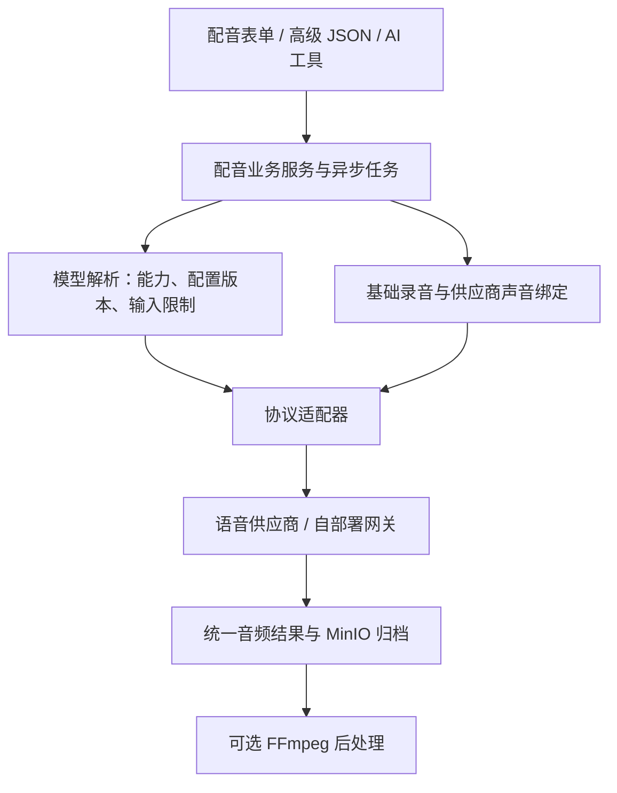

# 配音中心通用语音架构设计

状态：待实施设计。本文不表示现有配音代码已经完成通用化。

## 目标与事实

普通用户通过业务表单设计角色声音并生成配音；模型协议、声音注册步骤与原生参数由模型配置和适配层处理。保留高级 JSON 和模型 Skill，但不要求用户了解供应商协议。

声音设计、声音克隆和文本合成是不同能力，不能因为 modelType=TTS 就假定全部支持。更换模型也不能保证保留相同音色或同等情绪控制效果。

供应商存在两类典型链路：直接以参考音频合成；先创建或注册供应商声音，再使用声音句柄合成。注册接口可能绑定供应商账号、区域及目标模型。

依据：

- [MiMo 语音合成](https://mimo.mi.com/docs/en-US/quick-start/usage-guide/audio/speech-synthesis-v2.5)：声音设计与克隆为不同模型；克隆参考录音通过 audio.voice 输入。
- [阿里云声音设计 API](https://www.alibabacloud.com/help/en/model-studio/voice-design-api-references)：设计可返回 voice_id、预览音频和 target_model。
- [阿里云声音克隆](https://www.alibabacloud.com/help/en/model-studio/voice-cloning-user-guide)：声音绑定 target_model，不能直接用于其他模型。

## 分层

业务服务只管理角色、基础声音唯一性、任务、版本、引用、归档与特效。按显式 operation 和 capability 选择流程，不通过模型名称或自然语言关键词判断能力。

## 能力与操作

| 业务操作 / 能力 | 含义 | 产品行为 |
|---|---|---|
| VOICE_DESIGN | 从文字描述建立声音 | 允许通过音色描述创建基础声音 |
| VOICE_ENROLL | 从录音注册供应商声音 | 按需建立并复用供应商绑定 |
| SPEECH_SYNTHESIS | 用选定声音生成台词 | 配音生成的统一操作 |
| referenceAudio | 合成时能直接接收参考录音 | 可直接使用角色基础录音 |
| voiceHandle | 合成时能使用供应商声音句柄 | 必须解析兼容的供应商绑定 |
| presetVoice | 能使用预置声音 | 按模型配置提供选择 |
| performanceInstructions / inlineTags / emotionEnum | 实际支持的表演控制 | 仅显示适用的输入控件 |

页面中的“声音克隆”是业务流程：可能直接合成，也可能先注册再合成。operation 和声音输入类型分别建模，不强迫每家供应商实现同一种克隆接口。

表演能力、参数范围和参考录音限制必须按具体操作配置；同一供应商的不同模型或操作也可能不一致。模型不支持的输入应明确拒绝，不能静默丢弃或自动换模型。

## 模型中心配置

复用 ai_model.paramsJson 承载有版本的 speech 配置，避免第一阶段增加大量零散列。建议结构职责如下：

| 配置 | 职责 |
|---|---|
| adapter | 显式协议标识，例如 mimo-chat-audio-v1 |
| operations | 模型可执行的操作及各自输入能力 |
| inputSchema / uiSchema | 字段类型、必填、限制、标签、示例和有限控件布局 |
| requestMapping | 已支持协议内的字段路径、固定参数及显式枚举对应关系 |
| constraints | 按操作声明音频长度、大小、格式、语言与文本长度限制 |
| skillNames | 该模型与操作所需的知识技能 |

配置负责已有适配协议中的声明式差异，不提供脚本执行或任意 HTTP 编排。新增鉴权、上传注册流程、流式协议、轮询规则或响应封装时，新增适配器代码并测试，不宣称仅靠配置就能接入任何供应商。

前后端均按同一份已解析配置校验，后端为最终权威；返回给前端的是无密钥的能力与表单描述。管理员填写的请求映射不能覆盖账号鉴权和平台基础音频绑定。

## 请求与表单

统一业务请求表达 operation、modelId、baseAudioId、inputs、extensions 和 requestId。modelId、baseAudioId 等业务 ID 继续使用字符串。inputs 按操作的 inputSchema 校验：设计时包含音色描述与试音文本，合成时包含台词及模型支持的表演字段。

普通模式使用有限的输入控件，例如文本框、多行文本、下拉、滑块和音频资产选择。占位示例与“一键填充模板”来自所选模型及操作的配置，而非 Vue 按模型名判断。

高级模式提供原生 nativePayload 对象，与业务 inputs 分开保存。普通模式与高级模式明确记录当前编辑模式；无法无损还原的原生请求保持高级模式，不猜测反向转换，不丢弃额外参数。供应商鉴权与平台管理的基础音频不能通过高级模式覆盖。

台词的业务原文和供应商专用标签文本分开保存。例如 MiMo 的 `(愤怒)` 不作为通用台词直接发送给其他模型；切换模型时保留原始台词与创作者意图，为目标模型重新组织原生表达，并确认其兼容性。

适配器只做明确的数据转换。自由文本表演说明不能由 Java 关键词判断映射为情绪枚举；目标模型只支持枚举时，由用户显式选择，或由读取目标 Skill 的 AI 生成结构化结果供当前工作流使用。

## 声音资产与跨模型绑定

保留角色唯一活动基础声音的业务规则，以及基础录音、来源、转录、描述和版本。声音设计、上传录音和选择预置声音可以成为建立角色声音的不同入口，按能力显示。

供应商 voice_id / file_id 不能充当平台角色声音 ID。单独保存 voice_binding，关联基础声音版本、providerId、账号/区域作用域、目标模型及兼容版本、远端声音句柄、状态和注册来源。

同一基础声音版本可以拥有多个供应商绑定；不能把它们相互覆盖。绑定创建需要幂等控制，避免并发重复注册；供应商句柄失效时标记不可用并显式重建。替换基础声音后，不再为新任务复用旧版本绑定，历史任务保留原快照。

切换模型时：

1. 解析目标模型的合成与声音输入能力。
2. 若可直接接收录音，校验参考录音约束后使用基础录音。
3. 若需要声音句柄，查询同一声音版本及供应商作用域下的兼容绑定；缺少绑定时，通过目标模型支持的注册流程建立绑定。
4. 若无法使用此声音，提示选择兼容声音或重新建立基础声音；不静默切换预置音色。

基础录音可作为跨模型重建的素材，供应商句柄通常不可直接迁移。重建后的音色相似度、韵律与表演效果需要试听验收。

## 适配器与结果

建议 SpeechModelResolver 解析模型配置；SpeechWorkflowService 编排设计、注册、合成任务；SpeechProviderAdapter 提供其声明支持的操作。能力不支持时明确拒绝，不提供虚假的默认实现。

统一结果包含已获得的音频、格式、时长、供应商 requestId、实际使用模型、可选 voiceHandle，以及供应商原始响应摘要。兼容二进制、Base64、下载 URL 与异步结果，由适配器处理其协议细节。

最终配音仍统一归档平台音频资产，再进行可选 FFmpeg 后处理。供应商原生输出格式与最终归档格式分离，不在通用输入校验中固定要求所有供应商直接返回 WAV。

任务保存业务输入、配置与适配器版本、原生请求快照、基础声音版本、供应商绑定和结果信息。重试校验原配置及绑定是否仍可用；不可用时明确失败，不静默采用最新模型配置。快照支持追溯，不保证生成音频逐次一致。

## Skill 边界

Skill 解释模型的标签语法、音色描述、表演指导与创作示例，供 AI 按模型配置按需读取。能力配置负责机器可校验的接口事实；适配器负责确定的协议转换与生命周期。

用户普通表单直接走确定的请求构造，不为每次配音额外调用 LLM。AI 帮写与跨模型表演改写是可选能力，不成为基础配音的必经步骤。

## 现有实现的迁移顺序

1. 增加 speech 配置解析与能力查询，将现有 MiMo 声明为首个适配器；移除 DubbingService、模型列表与前端按 mimo 模型名判断操作的逻辑。
2. 配音页面与 MCP 共用通用业务请求，增加普通表单；保留现有 JSON 快照为 MiMo 高级模式历史数据，后端不猜测拆解旧标签。模板迁入模型配置。
3. 将 MiMo 的 messages 结构、audio.voice 编码、输出格式与响应解析限制收进适配器，通用层不依赖这些字段。
4. 增加声音供应商绑定，再接入第二种真实存在且协议不同的 TTS，验证注册、句柄复用、切换与失效处理。只实现已选供应商的能力，不虚构尚未接入的适配器。
5. 保持已有基础声音、克隆原声、特效、分镜引用与历史结果可用；新旧生成请求用明确版本区分，避免部分升级时误解释旧请求。

验收重点：不同操作的能力筛选、动态表单、普通/高级模式无数据丢失、跨供应商绑定隔离、注册幂等、未知能力拒绝、配置快照重试、旧音频可用性、分镜引用和 FFmpeg 原声复用。
