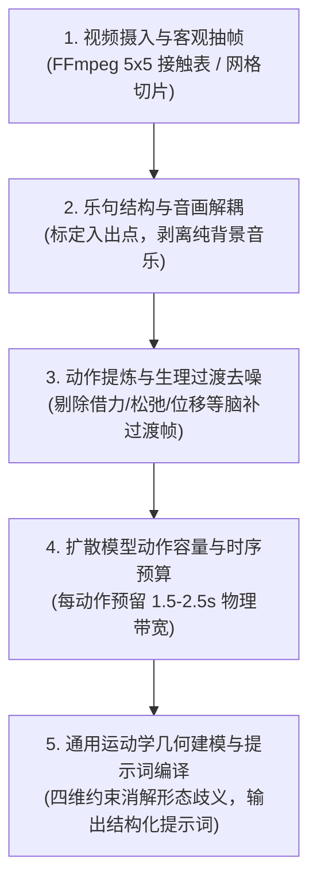
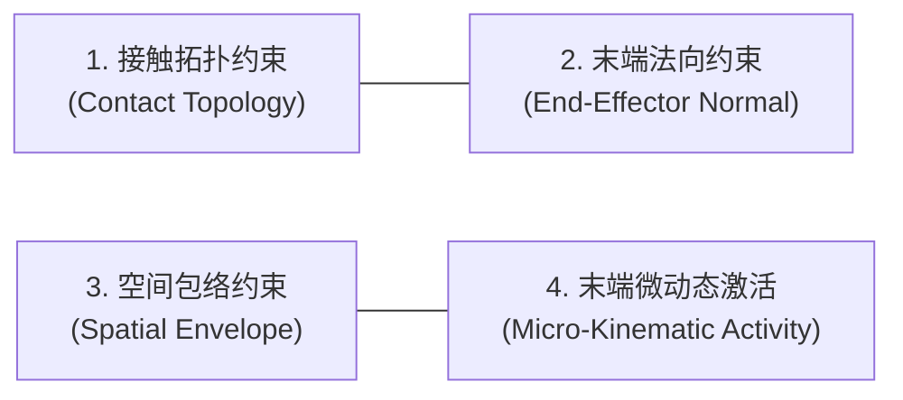

# 视频动作解析与动作编译技能 (Video Motion Analysis & Transcription)

本技能定义了通用 AI Agent 如何从一段真实视频（或动画素材）中，逆向解析角色的动态行为、提炼核心动作母题，并将其高保真、零歧义地编译为符合现代 AI 视频扩散模型（如 MiniMax H3、Runway、Sora、CogVideoX 等）要求的高精度提示词与分镜脚本。

---

## 核心工作流总览 (5 步标准化流水线)

---

## 阶段一：视频摄入与客观抽帧 (Frame-Level Inspection)

**严禁主观凭空猜测或仅依赖低分辨率粗扫记忆。**

1. **元数据探测**：
   使用 `ffprobe` 获取视频与音频的精确流信息（总时长精确至毫秒、帧率 FPS、分辨率、音频采样率）。
2. **多尺度接触表抽帧 (Contact Sheet Grids)**：
   不要单帧漫天乱截，必须使用脚本（如 `scripts/extract_motion_grids.py`）将视频按秒或节拍导出为紧凑的 **5x5 或 3x3 动作网格图**：
   - 宏观网格（每秒 1 帧）：定位大段落切换、音乐乐句起点；
   - 微观网格（每 0.2 秒 1 帧）：分析高频手势、手指翻转、步法换重心。
3. **划分镜头切点（Cut Points）**：
   - 依据舞蹈或动作的自然完型（Phrase Completion）切分镜头；
   - 现代扩散模型单镜头建议控制在 **7 ~ 10 秒**以内（过长会导致潜空间漂移与显存溢出）；
   - 在乐句终止、动作定格收势、或自然呼吸点进行逻辑分镜（例如 17.9 秒动作在 9.28 秒乐句收音处切分为 Shot 1 与 Shot 2）。

详见参考文档：[抽帧与时序预算规范](references/frame-extraction-and-pacing.md)。

---

## 阶段二：动作提炼与生理去噪 (Anti-Overinterpretation)

**这是防止“动作做不完”与“擅自加戏”最关键的一道闸门！**

### 1. 区分“主干锚点动作” vs “生理过渡缓冲帧”
- **真实人体的生物力学惯性**：
  真人跳舞或运动时，在执行下一个大动作之前必然存在准备动作、反向蓄力、呼吸回弹或重心微调。
  - *蓄力与反向运动（Anticipation）*：肢体下沉前先微抬借力、出拳前手肘微缩 ➔ **严禁**将其识别为独立的新动作并分配独立时限；
  - *松弛回弹（Relaxation）*：重音后身体或关节由于呼吸产生的微幅松弛 ➔ **严禁**将其命名为独立的摆动/摊手动作；
  - *空间位移过渡（Transit）*：肢体从 A 点平移至 B 点的过程属于路径过渡，只需在起止动作中描述终点空间坐标，不得为位移过程硬编中间动作。
- **提炼法则**：
  - 寻找动作的**造型终点（Keyframe Stance）**和**运动矢量（Motion Vector）**；
  - 忽略人体无意识的肌肉复位与惯性微动；
  - 整个单镜头只保留 **3 ~ 5 个核心主干动作**，其余全部交给扩散模型底层的物理动力学先验自然插值。

### 2. 动作去噪与判定审计
在下笔写提示词前，必须建立如下表格自审：

| 观察到的运动现象 | 是否属于主干意图 | 判定处理 | 理由 |
| :--- | :--- | :--- | :--- |
| 具有明确叙事或节奏表达的定型手势 | 是 (Core Anchor) | **保留** | 核心动作单元 |
| 动作承接或姿态换位 | 是 (Transition) | **合并或保留** | 确保肢体运动连续性 |
| 为发力而产生的蓄力微抬或下沉 | 否 (Anticipation) | **彻底剔除** | 属于生物惯性，写入会挤占模型时序带宽 |
| 伴随节奏的呼吸松弛微晃 | 否 (Relaxation) | **彻底剔除** | 属于生理微动，写入会强迫模型生硬变招 |

详见参考文档：[动作提炼与反脑补原则](references/anti-overinterpretation.md)。

---

## 阶段三：扩散模型动作容量与时序预算 (Temporal Budgeting)

**为什么动作会做不完？因为忽视了扩散模型的动作信息熵上限（Entropy Bottleneck）。**

1. **时序带宽物理法则**：
   - 扩散模型在生成视频时，潜空间（Latent Space）的帧间注意力（Temporal Attention）每秒能平滑变换的肢体姿态是有限的。
   - **单动作最小物理周期**：一个具有清晰起承转合的完整肢体动作，**至少需要 1.5 ~ 2.5 秒**；
   - **复杂多轴翻转/旋转动作**：涉及多个自由度联动复合演进的动作，**至少需要 3.0 ~ 3.5 秒**；
   - **动作容量红线**：在 8 ~ 9 秒的镜头中，**严禁排布超过 4 个复杂动作**。
2. **时间轴预算法（Pacing Budget）**：
   - **前松后宽**：绝对不能把前面的动作拉得很长，导致结尾最需要细节展示的收韵动作只剩下 1 秒仓促收场；
   - **留白与定格（Poise & Rest）**：每个镜头的尾部必须预留 **1.0 ~ 1.5 秒** 作为动作完型展示与从容定格（Hold Pose），让镜头在稳定的姿态与眼神中淡出或切镜。

---

## 阶段四：通用运动学几何建模 (Kinematic Geometry Formulation)

自然语言具有高度的多义性，扩散模型会按照其预训练语料库中最普遍的图文关联进行“懒惰联想”。必须采用**严格的通用运动学四维约束系统**替代日常模糊词汇：

### 1. 通用四维运动学约束系统
1. **接触拓扑约束 (Contact Topology & Closed-Loop)**：
   - 显式定义肢体间或肢体与环境的接触面（如点接触、面贴合、闭环互锁）；
   - 声明接触面的不可分离性与刚性约束（如“两表面紧密贴合为一个整体平面，严禁分离”），彻底杜绝模型因多峰采样将闭合结构错误拆分。
2. **末端法向约束 (End-Effector Orientation & Normal Vectors)**：
   - 显式指定关节末端（如手掌掌心、足底、面部）的朝向法向量（如面向躯干内侧、垂直面向镜头、水平朝下）；
   - 杜绝仅描述空间移动路径（如“向上/向下移动”）而忽略法向，防止末端肢体朝向反转或出现非自然翻转。
3. **空间包络约束 (Spatial Envelope & Amplitude Limits)**：
   - 采用相对身体基准的定量/半定量边界（如“活动范围保持在躯干轮廓以内”、“距离身体 5-10cm 舒适包络”），替代“适度”、“稍微”、“夸张”等主观形容词；
   - 杜绝主观词汇被扩散模型过度放大所导致的关节过屈、手肘大开或肢体失控挥舞。
4. **末端微动态激活 (Micro-Kinematic Activity & DOF Activation)**：
   - 当根部或大关节执行宏观位移时，显式约束末端自由度（如手指、手腕关节）的动态状态（是“独立活跃波动”、是“柔和弯曲”、还是“刚性锁定”）；
   - 杜绝模型在计算整体位移时产生“木偶滑块（Sliding Mannequin）”假死僵硬现象。

### 2. 音画解耦与防对嘴铁律 (The Zero Lip-Sync Protocol)
- **现象**：角色嘴型莫名其妙跟着背景音乐动，甚至出现开唇演唱怪异文字。
- **根因**：现代多模态模型的跨模态交叉注意力（Cross-Modal Attention）会将提示词中任何带有双引号或歌词字样的文本，强行归因并绑定为当前角色的口型发音指令。
- **铁律**：
  1. **提示词中 100% 剥离歌词或唱词文本**，仅保留纯粹物理节奏标定（如 `Beat 1-4`, `rhythmic measure`）；
  2. **声明角色为无声演员**：明确定义角色为“纯粹无声演职人员（strictly silent non-vocal subject who does not sing, speak, or lip-sync）”；
  3. **面部状态物理锁死**：显式声明“双唇始终紧闭保持自然平静微笑（lips gently and completely sealed in a natural warm smile）”；
  4. **负向词全局阻断**：显式配置 `lip sync, mouthing words, singing, moving mouth, open mouth, talking, speaking`。

详见参考文档：[通用运动学几何建模与消歧指南](references/kinematic-disambiguation.md)。

---

## 阶段五：生成标准结构化提示词 (Compilation)

根据上述流程提炼出的无歧义物理指令，最终编译为规范的结构化分镜提示词：

1. `subject_definitions`：定义角色、服装、场景与音频角色（无声演员）；
2. `summary`：镜头内核心 3-5 个锚点动作的宏观脉络；
3. `retention_analysis`：资产锁定、动作数量硬约束（STRICTLY N ACTIONS AND NO OTHERS）、面部闭口状态锁定；
4. `detailed_description`：带有精确时间戳（00:00.0-00:XX.X）的运镜、动作几何轨迹与节奏推进；
5. `overall_soundscape` & `non-diegetic_music`：音画空间解耦说明；
6. `negative_prompt`：明确拦截多余动作、肢体分离、张嘴、对嘴等退化模式。

完整标准模版与经典实战案例详见：[提示词编译模版与范例](references/h3-prompt-template.md)。

---

## 交付自检清单 (Checklist)

在输出最终分镜与提示词前，Agent 必须对照下列项逐条自查（全部符合方可交付）：

- [ ] **动作总数受控**：8~9 秒单镜头内主干动作严格 $\le 4$ 个？
- [ ] **无脑补过渡动作**：是否剔除了所有蓄力借力、生理松弛、空中平移等过渡动作？
- [ ] **时序预算充足**：结尾动作是否预留了 $\ge 3$ 秒的完整演练与定格留白时间？
- [ ] **运动学几何完备**：是否显式定义了接触拓扑（贴合/闭合）、末端法向朝向、空间包络范围与末端微动态？
- [ ] **防对嘴隔离完备**：动作描述中是否已经 100% 剔除了引用的歌词文字？是否声明了闭口无声表演者？
- [ ] **负向提示词覆盖**：是否包含了针对特定动作退化模式的负向排除词？
